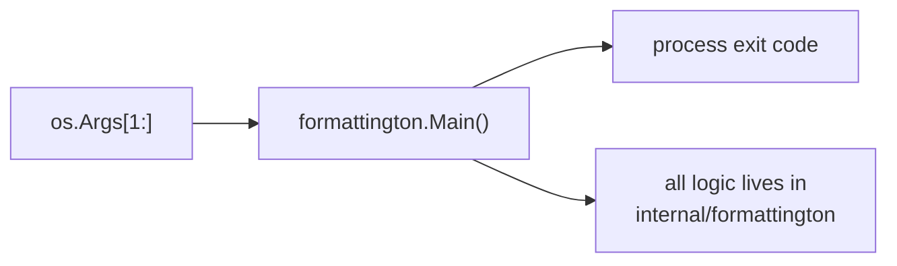

# Process entry point (`cmd/formattington/main.go`)



`main.go` is the process boundary: it calls `formattington.Main(os.Args[1:])` and exits with the returned code. There is no logic worth testing here — everything testable lives in `internal/formattington/` and is covered by `go test ./internal/formattington`.

```go
func main() {
	os.Exit(formattington.Main(os.Args[1:]))
}
```

The split exists so the whole CLI can be driven in-process from tests without a re-exec.

## Where to go next

- [Command dispatch and the tool registry](../../internal/formattington/cli.go.md)
- [Architecture diagram](../../internal/formattington/architecture.mmd)
