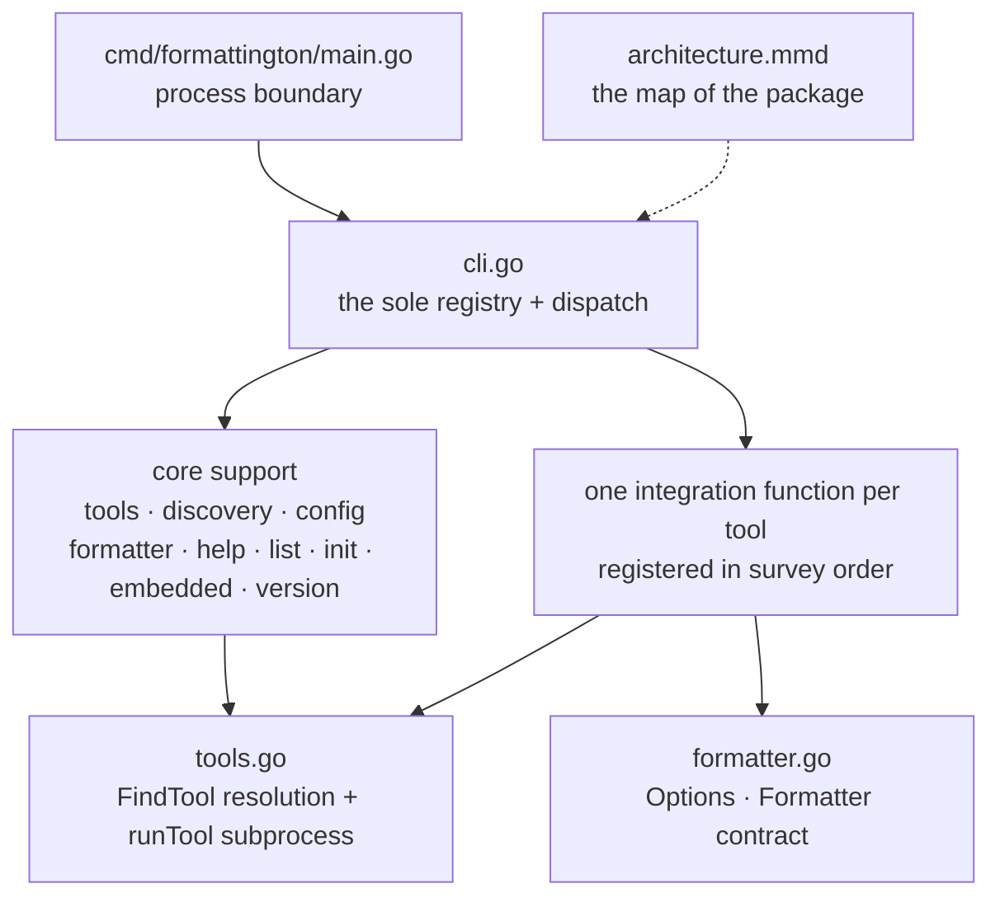

# The `internal/formattington` package

All of Formattington's implementation lives in this package: the CLI, the tool registry, discovery, configuration, and every formatter integration. `cmd/formattington/main.go` is a two-line shim over `Main` here.

If you want the big picture first, open the [architecture diagram](architecture.mmd), then [cli.go.md](cli.go.md). To refresh the bundled helper binaries, see `tools/README.md`; to render this documentation, see [scripts/docs.sh.md](../../scripts/docs.sh.md).

## The contract with the integrations

Every integration is a function with the signature `func(Options) (int, error)` ([formatter.go.md](formatter.go.md)), registered by name in `cli.go`'s `registry` ([cli.go.md](cli.go.md)), resolving its executable through `FindTool` ([tools.go.md](tools.go.md)), and receiving pre-discovered files from `DiscoverFiles` ([discovery.go.md](discovery.go.md)). Exit codes above `0` are upstream exit codes; `1` is reserved for "files need formatting" (`ExitFormatRequired`), `127` for a missing tool, and `2` for usage errors.

## Core pages

- [Command dispatch and the tool registry — cli.go](cli.go.md)
- [Tool discovery and subprocess helpers — tools.go](tools.go.md)
- [Execution options and the Formatter contract — formatter.go](formatter.go.md)
- [File discovery — discovery.go](discovery.go.md)
- [Configuration files — config.go](config.go.md)
- [Help output — help.go](help.go.md)
- [Version resolution — version.go](version.go.md)
- [The `list` command — list.go](list.go.md)
- [The `init` command and embedded catalogue — init.go](init.go.md)
- [Embedded formatter payloads — embedded.go](embedded.go.md)
- [Architecture diagram — architecture.mmd](architecture.mmd)
- [Process entry point — cmd/formattington/main.go](../../cmd/formattington/main.go.md)

## Integration pages (registration order)

The order mirrors the registry — Stack Overflow Developer Survey 2026 popularity order (see [AGENTS.md](../../AGENTS.md)), not alphabetical:

| Tool               | Language(s)                       | Docs                                                 |
| ------------------ | --------------------------------- | ---------------------------------------------------- |
| prettier           | JS/TS/CSS/HTML/Markdown/JSON/YAML | [prettier.go.md](prettier.go.md)                     |
| sqlfluff           | SQL                               | [sqlfluff.go.md](sqlfluff.go.md)                     |
| black              | Python                            | [black.go.md](black.go.md)                           |
| shfmt              | Shell                             | [shfmt.go.md](shfmt.go.md)                           |
| google-java-format | Java                              | [google_java_format.go.md](google_java_format.go.md) |
| dotnet-format      | C#/VB.NET                         | [dotnet_format.go.md](dotnet_format.go.md)           |
| powershell         | PowerShell                        | [powershell.go.md](powershell.go.md)                 |
| clang-format       | C/C++/Obj-C/…                     | [clang_format.go.md](clang_format.go.md)             |
| rustfmt            | Rust                              | [rustfmt.go.md](rustfmt.go.md)                       |
| php-cs-fixer       | PHP                               | [php_cs_fixer.go.md](php_cs_fixer.go.md)             |
| gofmt              | Go                                | [gofmt.go.md](gofmt.go.md)                           |
| goimports          | Go                                | [goimports.go.md](goimports.go.md)                   |
| ktfmt              | Kotlin                            | [ktfmt.go.md](ktfmt.go.md)                           |
| stylua             | Lua                               | [stylua.go.md](stylua.go.md)                         |
| swift-format       | Swift                             | [swift_format.go.md](swift_format.go.md)             |
| rubocop            | Ruby                              | [rubocop.go.md](rubocop.go.md)                       |
| dart-format        | Dart                              | [dart_format.go.md](dart_format.go.md)               |
| styler             | R                                 | [styler.go.md](styler.go.md)                         |
| nixfmt             | Nix                               | [nixfmt.go.md](nixfmt.go.md)                         |
| gdformat           | GDScript                          | [gdformat.go.md](gdformat.go.md)                     |
| npm-groovy-lint    | Groovy                            | [npm_groovy_lint.go.md](npm_groovy_lint.go.md)       |
| perltidy           | Perl                              | [perltidy.go.md](perltidy.go.md)                     |
| zig-fmt            | Zig                               | [zig_fmt.go.md](zig_fmt.go.md)                       |
| mix-format         | Elixir                            | [mix_format.go.md](mix_format.go.md)                 |
| fourmolu           | Haskell                           | [fourmolu.go.md](fourmolu.go.md)                     |
| scalafmt           | Scala                             | [scalafmt.go.md](scalafmt.go.md)                     |
| fprettify          | Fortran                           | [fprettify.go.md](fprettify.go.md)                   |
| erlfmt             | Erlang                            | [erlfmt.go.md](erlfmt.go.md)                         |
| jlfmt              | Julia                             | [jlfmt.go.md](jlfmt.go.md)                           |
| cljfmt             | Clojure                           | [cljfmt.go.md](cljfmt.go.md)                         |
| gleam-format       | Gleam                             | [gleam_format.go.md](gleam_format.go.md)             |
| gnatformat         | Ada                               | [gnatformat.go.md](gnatformat.go.md)                 |
| fantomas           | F#                                | [fantomas.go.md](fantomas.go.md)                     |
| ocamlformat        | OCaml                             | [ocamlformat.go.md](ocamlformat.go.md)               |
| forge-fmt          | Solidity                          | [forge_fmt.go.md](forge_fmt.go.md)                   |
| mojo-format        | Mojo                              | [mojo_format.go.md](mojo_format.go.md)               |
| odinfmt            | Odin                              | [odinfmt.go.md](odinfmt.go.md)                       |
| elm-format         | Elm                               | [elm_format.go.md](elm_format.go.md)                 |
| markdownlint       | Markdown (lint)                   | [markdownlint.go.md](markdownlint.go.md)             |
| taplo              | TOML                              | [taplo.go.md](taplo.go.md)                           |

## Testing

Tests live next to the code as `*_test.go` and run without network access or installed formatter binaries (fake executables in temporary directories; tool discovery is pointed at stub trees). Run them with `make test` (or `make check` for vet + gofmt + tests). The suite also round-trips `init.json` against every registered tool.
