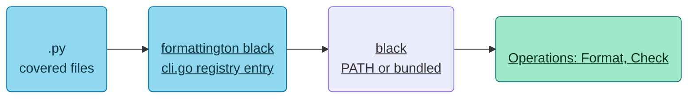

# Black (`black`)

Black is the uncompromising Python code formatter. It covers `.py` files and is the Python formatter of record for Formattington.

## At a glance

|                      |                                                                                     |
| -------------------- | ----------------------------------------------------------------------------------- |
| Executable           | `black`                                                                             |
| Resolution           | Resolved from PATH or the bundled formatters (bundled in the full release archives) |
| Extensions           | `.py`                                                                               |
| Operations           | Format, Check                                                                       |
| Language aliases     | `python` → `black`, `py` → `black`, `micropython` → `black`                         |
| Native configuration | `pyproject.toml` `[tool.black]` (data-only)                                         |

## Behavior

- Default invocation: `black` — format in place (no flag is added)
- `--check`: `black --check` — fail if any file needs formatting; files are not modified
- `--dry-run`: `black --diff` — print a diff, do not modify
- Forwarded arguments: forwarded verbatim to `black`; no flags are injected (in particular, no `--line-length` unless you pass one yourself)
- Exit codes: no remapping — codes pass through as Black reports them (`--check` exits 1 when formatting is required)

## Notes

- Black is bundled in the full release archives; the bundle's macOS x86_64 build is compiled from source by `formatters/black/update.sh` on a native Intel Mac (the tag's commit hash is pinned). PATH installs use `pip install black` or `uv tool install black`.
- Black respects `pyproject.toml` `[tool.black]` and adds no style flags of its own.
- MicroPython is covered by Black: it is a Python 3 subset and parses/formats cleanly under Black, so `formattington micropython` (alias for `black`) and `formattington python` both format `.py` MicroPython files. Statement-level `label:` statements inside inline-assembly functions are not valid Python and cannot be parsed; those functions must be excluded or kept minimal by hand.
- `.formattington.json` commands such as `["black", "--check", "src"]` behave exactly like `formattington black --check src`.

## Related pages

- [Command dispatch and the tool registry](cli.go.md)
- [Tool discovery, bundling, and shared subprocess helpers](tools.go.md)
- [Execution options and the Formatter contract](formatter.go.md)
- [AGENTS.md](../../AGENTS.md)
- [README.md](../../README.md)
- Upstream: https://github.com/psf/black
