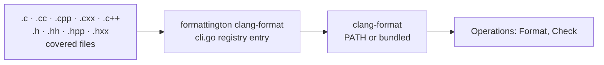

# clang-format (`clang-format`)

clang-format is LLVM's C/C++/Objective-C family code formatter. Formattington registers it for C, C++, and C/C++ header files.

## At a glance

|                      |                                                                                     |
| -------------------- | ----------------------------------------------------------------------------------- |
| Executable           | `clang-format`                                                                      |
| Resolution           | Resolved from PATH or the bundled formatters (bundled in the full release archives) |
| Extensions           | `.c`, `.cc`, `.cpp`, `.cxx`, `.c++`, `.h`, `.hh`, `.hpp`, `.hxx`                    |
| Operations           | Format, Check                                                                       |
| Language aliases     | `c` → `clang-format`, `cpp` → `clang-format`, `c++` → `clang-format`                |
| Native configuration | `.clang-format` (data-only)                                                         |

## Behavior

- Default invocation: `clang-format -i <files...>` — format in place (`-i` is not re-added if you pass your own `-i` or `--in-place`)
- `--check`: `clang-format --dry-run --Werror` — fail if any file needs formatting; files are not modified
- `--dry-run`: `clang-format --dry-run` — validate without modifying files
- Forwarded arguments: forwarded verbatim to `clang-format`; a caller-provided `-i`/`--in-place` suppresses the injected `-i` in default mode
- Exit codes: no remapping — codes pass through as clang-format reports them

## Notes

- clang-format is part of LLVM; install it with your OS package manager (for example `brew install clang-format` or `apt install clang-format`) or via the LLVM project. The full release archives bundle it; the bundled binaries come from the clang-tools-static-binaries repackaging of upstream LLVM (Unlicense; upstream LLVM is Apache-2.0 WITH LLVM-exception).
- Configuration is `.clang-format`, discovered by the tool itself and respected as-is.
- Paths with spaces are safe: discovered files are passed as discrete arguments.
- Informational passthroughs (`--help`, `--version`) never trigger file discovery.

## Related pages

- [Command dispatch and the tool registry](cli.go.md)
- [Tool discovery, bundling, and shared subprocess helpers](tools.go.md)
- [Execution options and the Formatter contract](formatter.go.md)
- [AGENTS.md](../../AGENTS.md)
- [README.md](../../README.md)
- Upstream: https://github.com/cpp-linter/clang-tools-static-binaries (LLVM via https://github.com/llvm/llvm-project)
