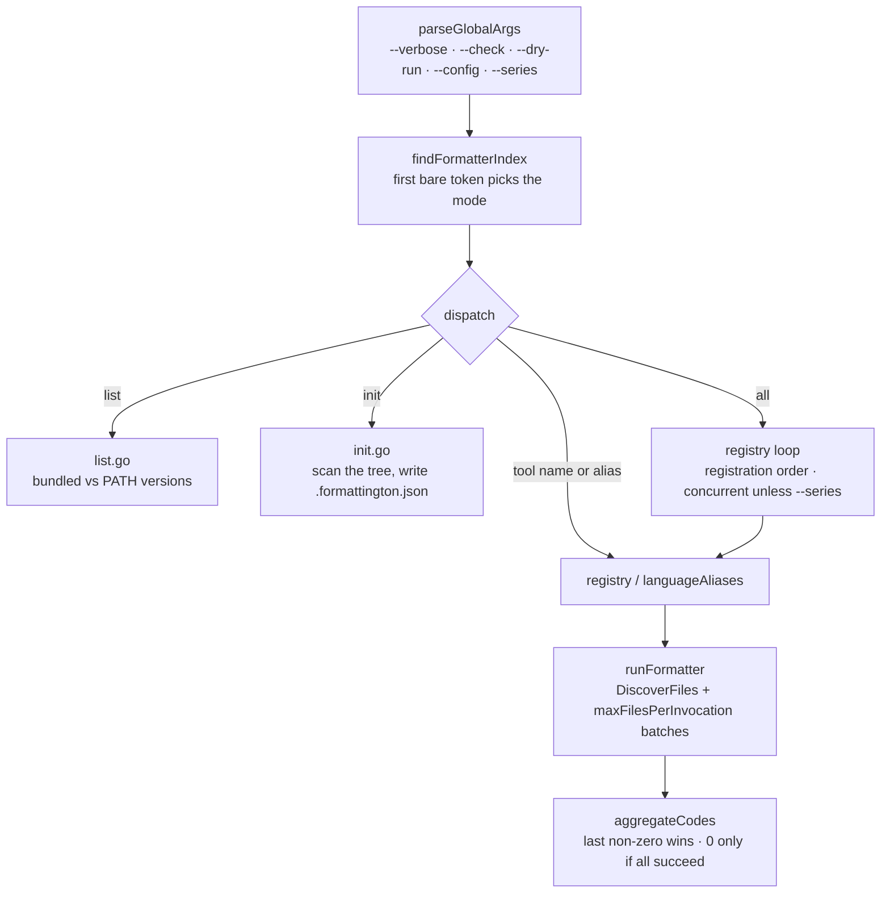

# Command dispatch and the tool registry (`cli.go`)

`cli.go` is the canonical command-line entry point (`Main`) and the sole registry of formatter integrations. Every other file in the package either supports dispatch (discovery, tool resolution, configuration) or implements one integration.

## The registry

`registry` (line ~21) maps each tool name to its `Formatter` implementation. Its order is deliberate — it is the order `formattington all` runs in and the order exit codes are aggregated in. The order is the Stack Overflow Developer Survey 2026 popularity ranking (see [AGENTS.md — presentation order](../../AGENTS.md)), not alphabetical.

`languageAliases` (line ~68) maps language and file-type names onto registered tools — for example `md`/`markdown`/`html` → `prettier`, `python`/`py` → `black`, `c`/`cpp`/`c++` → `clang-format`. Unrecognized words are a usage error (exit 2); an alias whose backend is not registered reports `'<name>' is not yet supported`.

The registry order is mirrored by [init.json](init.go.md), the hardcoded order lists in [help.go.md](help.go.md), [README.md](../../README.md), and [AGENTS.md](../../AGENTS.md) — change them together.

## Dispatch flow

`Main(argv)` (line ~137):

1. Parses global options with `parseGlobalArgs` — `--verbose`, `--check`, `--dry-run`, `--config`, `--series`. Selecting a tool must come from the first bare token that is not consumed as an option value (`findFormatterIndex`, line ~326).
2. Dispatches to `list`/`init`, to `all` (registry loop, concurrent with `--series` for sequential), to a registered tool by name, or to a language alias.
3. Runs each tool through `runFormatter` (line ~447): resolves embedding/discovery (`DiscoverFiles`), batches by `maxFilesPerInvocation`, calls the integration with `Options`.
4. Aggregates results with `aggregateCodes` (line ~511) — the last non-zero code wins; `0` only if all succeed. Missing tools become exit `127` but never prevent other formatters from running.

`runFormatter` discovers files itself when the user supplied no explicit file arguments: matching extensions for that formatter are appended to the invocation in batches. Explicit file arguments are passed verbatim (`hasUserFileArgs`, line ~488). `IsInformational` check/version passthroughs (`--help`, `--version`) are never given discovered files.

Execution flows through one path: `targetsFromNames`/`targetsFromCommands` build `runTarget`s (a resolved tool name plus forwarded arguments; element 0 of a config command is resolved through `languageAliases` by `resolveTarget`), and `runTargets` dispatches them either to `runTargetsSeries` (`--series`) or `runTargetsParallel` (the default; aggregation in target order, interleaved output possible). Flag restrictions for `list`/`init` funnel through `unsupportedMix` (extra arguments, `--check`, `--dry-run`, `--series`, `--config`).

## Options carried to integrations

`Options` (see [formatter.go.md](formatter.go.md)) is the per-run bundle: `Check`, `DryRun`, `Args` (forwarded verbatim), `Verbose`.

## Related pages

- [Tool discovery, bundling, and shared subprocess helpers](tools.go.md)
- [File discovery](discovery.go.md)
- [Configuration file loading (`.formattington.json`)](config.go.md)
- [Execution options and the Formatter contract](formatter.go.md)
- [Architecture diagram](architecture.mmd)
- [list command](list.go.md) · [init command](init.go.md) · [help output](help.go.md) · [version resolution](version.go.md)
