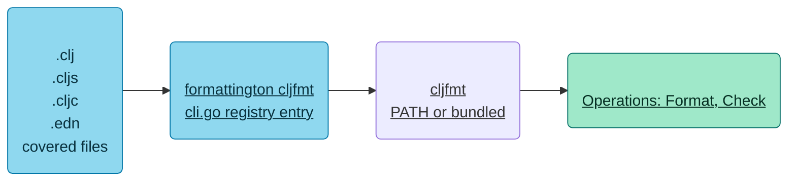

# cljfmt (`cljfmt`)

cljfmt is a Clojure code formatter (github.com/weavejester/cljfmt). Formattington registers it for Clojure, ClojureScript, cljc, and EDN files.

## At a glance

|                      |                                                                                                                                                                                  |
| -------------------- | -------------------------------------------------------------------------------------------------------------------------------------------------------------------------------- |
| Executable           | `cljfmt`                                                                                                                                                                         |
| Resolution           | Resolved from PATH or the bundled formatters (bundled for macOS arm64, Linux arm64, Linux x86_64 static, Windows x86_64; no macOS x86_64 or Windows arm64 asset exists upstream) |
| Extensions           | `.clj`, `.cljs`, `.cljc`, `.edn`                                                                                                                                                 |
| Operations           | Format, Check                                                                                                                                                                    |
| Language aliases     | `clojure` → `cljfmt`                                                                                                                                                             |
| Native configuration | `.cljfmt.edn` / `cljfmt.edn` (discovered by the tool itself; data-only)                                                                                                          |

## Behavior

- Default invocation: `cljfmt fix` — format in place
- `--check`: `cljfmt check` — print a unified diff and exit 1 when files need formatting (0 when clean)
- `--dry-run`: same as `--check` — `cljfmt check` IS cljfmt's diff mode (there is no separate diff mode)
- Forwarded arguments: forwarded verbatim (`--config FILE` is honored); the tool is subcommand-shaped, not flag-shaped
- Exit codes: no remapping — exit 2 (parse/format error) passes through verbatim and is never conflated with exit 1

## Notes

- cljfmt is subcommand-shaped (`cljfmt fix` / `cljfmt check`), not flag-shaped; Formattington maps its check/dry-run modes onto `cljfmt check` and its default mode onto `cljfmt fix`.
- The full release archives bundle the four upstream native binaries (macOS arm64, Linux arm64, Linux x86_64 static, Windows x86_64). cljfmt is distributed under EPL-1.0; the redistributed binaries are unmodified upstream build artifacts.
- The `check` subcommand prints the unified diff, so `--dry-run` output doubles as the diff view.
- Configuration is discovered by the tool itself (`.cljfmt.edn`/`cljfmt.edn` in the working directory and parents); `--config` is forwarded verbatim.

## Related pages

- [Command dispatch and the tool registry](cli.go.md)
- [Tool discovery, bundling, and shared subprocess helpers](tools.go.md)
- [Execution options and the Formatter contract](formatter.go.md)
- [AGENTS.md](../../AGENTS.md)
- [README.md](../../README.md)
- Upstream: https://github.com/weavejester/cljfmt
