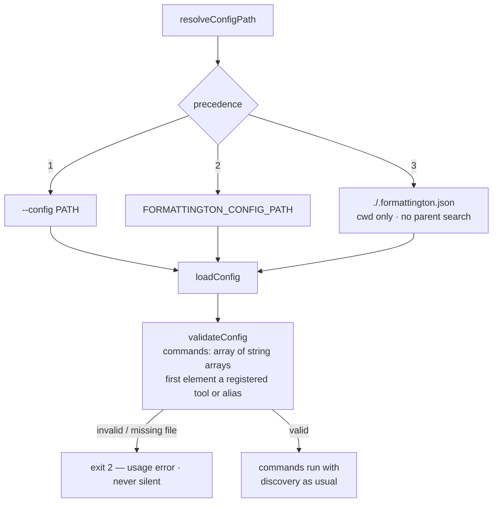

# Configuration files (`config.go`)

`config.go` loads and validates the optional `.formattington.json` that rebinds which commands `formattington` runs for each language — for example wiring `formattington all` to a project's own set of invocations.

## What it accepts

A configuration file carries a `commands` array of argument arrays (this repository's own file is a representative example). Each entry names a registered tool followed by the arguments to pass it. The default invocation (discovery supplies matching files, as usual) is what `init` writes; explicit `[...]` argument lists are appended verbatim when present.

Validation (`validateConfig`) checks the shape — a JSON object with only a `commands` key, an array of string arrays whose first element is a registered tool name or alias; anything else is a located error (`pyRepr` renders values in Python `repr()` style, so validation messages stay familiar to Python-literate readers). A missing `commands` key and unknown keys are both rejected, as are unknown tools and aliases that resolve to unregistered backends (`'<alias>' is not yet supported`). `commands: []` is valid and runs nothing. String (shell-style) entries and empty command lists are rejected — configuration is never passed through a shell.

`resolveConfigPath` (line ~27) picks the path by precedence: explicit `--config PATH` wins, then `FORMATTINGTON_CONFIG_PATH`, then `./.formattington.json` in the working directory only (no parent search). `loadConfig` (line ~171) returns the commands, the source label (`--config`, `FORMATTINGTON_CONFIG_PATH`, or `auto-discovered .formattington.json`), and the path for error messages. Missing or malformed configuration is a usage error (exit `2`), never a silent fallback; no config means the full registry-driven `all` behaviour.

## Related pages

- [init command](init.go.md) — writes this file; the embedded catalogue it draws from is [init.json](init.go.md)
- [Command dispatch and the tool registry](cli.go.md)
- [README.md — configuration section](../../README.md)
