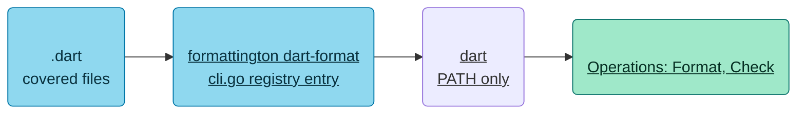

# dart format (`dart-format`)

`dart format` is the Dart SDK's built-in formatter. Formattington invokes it as `dart format` and registers the tool under the name `dart-format`.

## At a glance

|                      |                                                                                                                                                                                                              |
| -------------------- | ------------------------------------------------------------------------------------------------------------------------------------------------------------------------------------------------------------ |
| Executable           | `dart` (via `dart format`)                                                                                                                                                                                   |
| Resolution           | PATH-only (ships with the Dart SDK); invoked via `FindTool("dart")`                                                                                                                                          |
| Extensions           | `.dart`                                                                                                                                                                                                      |
| Operations           | Format, Check                                                                                                                                                                                                |
| Language aliases     | `dart` → `dart-format`                                                                                                                                                                                       |
| Native configuration | `analysis_options.yaml` `formatter:` section (`page_width`, `trailing_commas: preserve`; language version ≥ 3.7) and per-file `// dart format width=NNN` markers — discovered by the tool itself (data-only) |

## Behavior

- Default invocation: `dart format` — format in place
- `--check`: `dart format --set-exit-if-changed -o none` — exit 1 when changes are needed; writes nothing (`-o none` selects the null output)
- `--dry-run`: same as `--check` (never writes)
- Forwarded arguments: forwarded verbatim to `dart format`
- Exit codes: no remapping — exit 1 when changes are required, as reported by the tool

## Notes

- The Formattington tool name is `dart-format` (the binary is `dart`; `"dart"` alone would shadow the SDK's own CLI shape), and the `dart` language alias resolves to it.
- Nothing is invented configuration-wise: `analysis_options.yaml` and the `// dart format width=NNN` per-file marker are discovered by the tool itself.
- Install the Dart SDK for your platform (for example `brew install dart`); `dart format` ships with it.
- `--check` and `--dry-run` both map to `--set-exit-if-changed -o none`, so check mode conveys the changes-needed status without writing files.

## Related pages

- [Command dispatch and the tool registry](cli.go.md)
- [Tool discovery, bundling, and shared subprocess helpers](tools.go.md)
- [Execution options and the Formatter contract](formatter.go.md)
- [AGENTS.md](../../AGENTS.md)
- [README.md](../../README.md)
- Upstream: https://github.com/dart-lang/sdk
