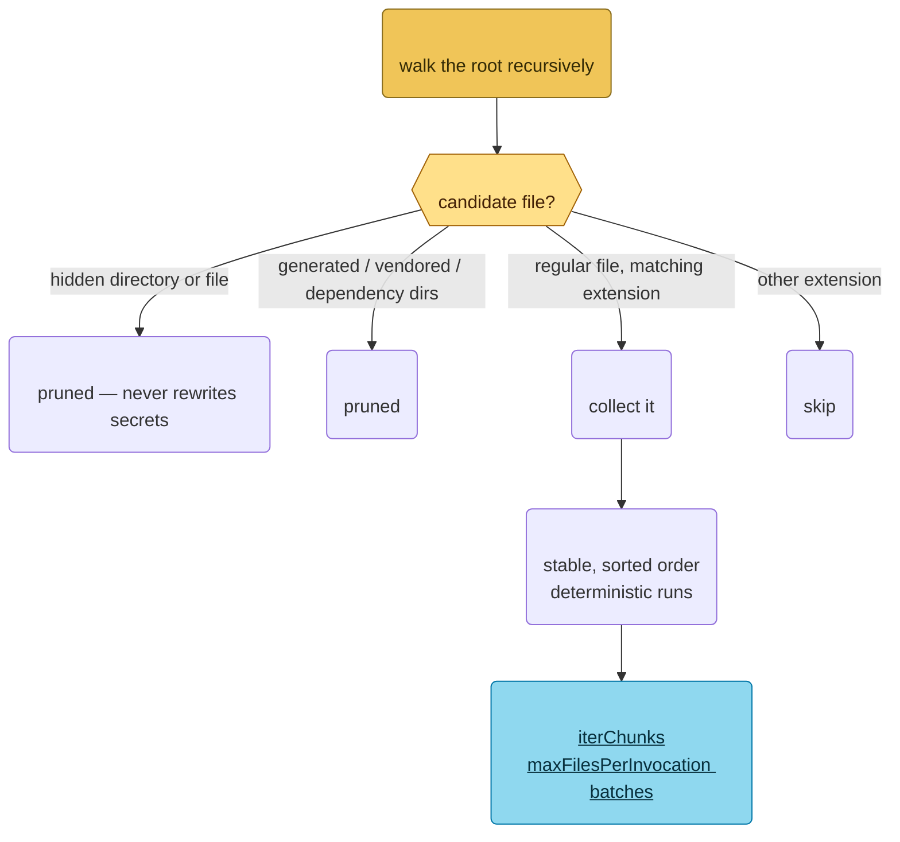

# File discovery (`discovery.go`)

`discovery.go` finds the files an integration will be offered when the user names no explicit paths.

## Rules

`DiscoverFiles(extensions, root)` (line ~25) recursively walks `root` and returns files whose extension matches one of the integration's extensions. It skips generated, vendored, and dependency content — the usual package-manager and build directory names — plus hidden directories, matching the repository's `.gitignore`-style expectations for a formatter run.

Hidden files and directories are excluded so a default run never rewrites secrets or tool internals; the `init` command applies its own, separate scan rules (see [init.go.md](init.go.md)) because writing a project config is a different contract than formatting a tree.

Discovery is case-sensitive on the extension and returns stable, sorted order so runs are deterministic and batching (`iterChunks` in [tools.go.md](tools.go.md)) preserves it.

## Where it is used

`runFormatter` in [cli.go](cli.go.md) calls discovery only when the user passed no explicit file arguments (and the args are not informational help/version passthroughs). All matches for a tool are appended to the invocation in batches of at most `maxFilesPerInvocation`.

## Related pages

- [Command dispatch and the tool registry](cli.go.md)
- [Tool discovery, bundling, and shared subprocess helpers](tools.go.md)
- [init command](init.go.md)
