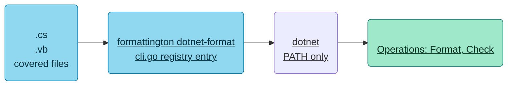

# dotnet format (`dotnet-format`)

`dotnet format` is the .NET SDK's in-box formatter (≥ 6). It covers C# (`.cs`) and VB.NET (`.vb`) files via the `whitespace` subcommand.

## At a glance

|                      |                                                                                |
| -------------------- | ------------------------------------------------------------------------------ |
| Executable           | `dotnet` (via `dotnet format`)                                                 |
| Resolution           | PATH-only (ships in-box with the .NET SDK ≥ 6)                                 |
| Extensions           | `.cs`, `.vb`                                                                   |
| Operations           | Format, Check                                                                  |
| Language aliases     | `csharp` → `dotnet-format`, `vbnet` → `dotnet-format`                          |
| Native configuration | `.editorconfig` only (whitespace mode; the project is never built) (data-only) |

## Behavior

- Default invocation: `dotnet format whitespace --folder . --include <files...>` — format in place (no MSBuild project or solution required; VB.NET is covered by the same binary)
- `--check`: `dotnet format whitespace --verify-no-changes --folder . --include <files...>` — exit 2 when changes are needed, reported as `ExitFormatRequired` (1)
- `--dry-run`: same as `--check` (never writes)
- Forwarded arguments: forwarded verbatim; if the first forwarded argument is a subcommand (`whitespace`, `style`, `analyzers`) or a project/solution path (`.sln`, `.csproj`, `.vbproj`, `.fsproj`), the invocation switches to verbatim mode (e.g. `formattington dotnet-format style --severity info src/app.csproj`); `--report <dir>` emits JSON reports
- Exit codes: `--verify-no-changes` exit 2 is reported as `ExitFormatRequired` (1); all other codes pass through

## Notes

- The `whitespace` subcommand is used by default with `--folder . --include <files>`: it needs no MSBuild project or solution and never runs project code.
- **Trust boundary:** the `style` and `analyzers` subcommands can restore and compile project code. They are available verbatim when you opt in via the first forwarded argument, but are never invoked by default.
- `.editorconfig` is the only configuration source; it is discovered by the tool itself. Style/analyzers restore behavior is opt-in only.
- When discovery finds nothing and no arguments are given, the tool is still invoked once with `format --version` (a harmless no-op) to preserve the suite-wide contract that the selected tool runs.
- `--diagnostics` takes a space-separated list and cannot be distinguished generically from file paths; use a config command if you need it.
- See [fantomas.go.md](fantomas.go.md) for the F# formatter, which also ships via the .NET ecosystem.

## Related pages

- [Command dispatch and the tool registry](cli.go.md)
- [Tool discovery, bundling, and shared subprocess helpers](tools.go.md)
- [Execution options and the Formatter contract](formatter.go.md)
- [AGENTS.md](../../AGENTS.md)
- [README.md](../../README.md)
- Upstream: https://github.com/dotnet/sdk
