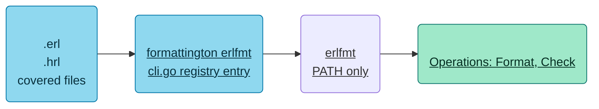

# erlfmt (`erlfmt`)

erlfmt (github.com/WhatsApp/erlfmt) is the mature Erlang formatter. Formattington registers it for Erlang source and header files.

## At a glance

|                      |                                                                                                             |
| -------------------- | ----------------------------------------------------------------------------------------------------------- |
| Executable           | `erlfmt`                                                                                                    |
| Resolution           | PATH-only (no bundleable binaries; ships as a rebar3 plugin or escript built from it; needs Erlang/OTP 21+) |
| Extensions           | `.erl`, `.hrl`                                                                                              |
| Operations           | Format, Check                                                                                               |
| Language aliases     | `erlang` → `erlfmt`                                                                                         |
| Native configuration | none (erlfmt takes no configuration file by design)                                                         |

## Behavior

- Default invocation: `erlfmt -w` — format in place
- `--check`: `erlfmt -c` — fail if any file needs formatting; files are not modified
- `--dry-run`: same as `--check` (there is no diff mode)
- Forwarded arguments: forwarded verbatim to `erlfmt`
- Exit codes: no remapping — `erlfmt -c` exits 1 when any file needs formatting (0 otherwise)

## Notes

- There are no bundleable binaries — erlfmt ships as source (a rebar3 plugin or an escript built from it), so it is PATH-only and needs a working Erlang/OTP 21+ install.
- Invoke the escript form (`erlfmt -w` / `erlfmt -c`); a standalone `erlfmt` escript or one made available via the project's rebar3 build both satisfy discovery.
- erlfmt takes no configuration file by design; formatting style is fixed by the tool.
- `-c` is the check mapping and the dry-run mapping; there is no diff mode, so dry-run does not print a diff.

## Related pages

- [Command dispatch and the tool registry](cli.go.md)
- [Tool discovery, bundling, and shared subprocess helpers](tools.go.md)
- [Execution options and the Formatter contract](formatter.go.md)
- [AGENTS.md](../../AGENTS.md)
- [README.md](../../README.md)
- Upstream: https://github.com/WhatsApp/erlfmt
