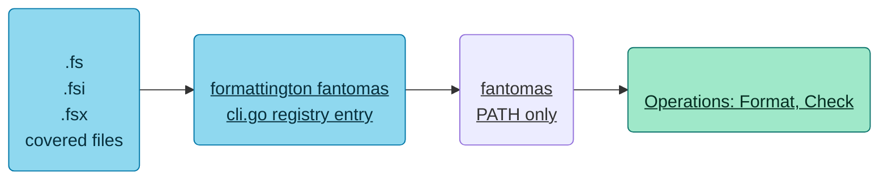

# Fantomas (`fantomas`)

Fantomas (github.com/fsprojects/fantomas) is the F# toolchain formatter. Formattington registers it for F# source, signature, and script files.

## At a glance

|                      |                                                                                                                                              |
| -------------------- | -------------------------------------------------------------------------------------------------------------------------------------------- |
| Executable           | `fantomas`                                                                                                                                   |
| Resolution           | PATH-only (ships only as a .NET global tool; needs the .NET SDK ≥ 8)                                                                         |
| Extensions           | `.fs`, `.fsi`, `.fsx`                                                                                                                        |
| Operations           | Format, Check                                                                                                                                |
| Language aliases     | `fsharp` → `fantomas`                                                                                                                        |
| Native configuration | `.editorconfig` (many options are picked up automatically) plus `.fantomasignore` for exclusions — discovered by the tool itself (data-only) |

## Behavior

- Default invocation: `fantomas` — format in place (no flag is added)
- `--check`: `fantomas --check` — exit 99 when files need formatting; never writes. Exit 99 is reported as `ExitFormatRequired` (1); exit 1 (error) passes through
- `--dry-run`: same as `--check` (there is no diff mode)
- Forwarded arguments: forwarded verbatim to `fantomas`
- Exit codes: exit 99 in check mode reported as `ExitFormatRequired` (1); exit 1 (error) passes through untouched; everything else passes through

## Notes

- Fantomas ships only as a .NET global tool (NuGet nupkgs) — embedding the .NET runtime is out of scope, so it is PATH-only. Install with `dotnet tool install -g fantomas` (.NET SDK ≥ 8).
- Its `--check` exits **99** when formatting is needed (0 clean, 1 error); Formattington reports 99 as `ExitFormatRequired` (1) and passes 1 through.
- Configuration is `.editorconfig` (many options picked up automatically) plus `.fantomasignore` for exclusions; both are discovered by the tool itself.
- See [dotnet-format](dotnet_format.go.md) for the other .NET-ecosystem integration (C#/VB.NET).

## Related pages

- [Command dispatch and the tool registry](cli.go.md)
- [Tool discovery, bundling, and shared subprocess helpers](tools.go.md)
- [Execution options and the Formatter contract](formatter.go.md)
- [AGENTS.md](../../AGENTS.md)
- [README.md](../../README.md)
- Upstream: https://github.com/fsprojects/fantomas
