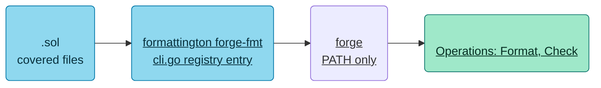

# forge fmt (`forge-fmt`)

`forge fmt` is the standard Solidity formatter, shipped with Foundry. Formattington invokes the `forge` binary's `fmt` subcommand and registers the tool as `forge-fmt`.

## At a glance

|                      |                                                                                                                                                                                                                               |
| -------------------- | ----------------------------------------------------------------------------------------------------------------------------------------------------------------------------------------------------------------------------- |
| Executable           | `forge` (via `forge fmt`)                                                                                                                                                                                                     |
| Resolution           | PATH-only (ships with Foundry — `foundryup`, Homebrew, npm, or release tarballs)                                                                                                                                              |
| Extensions           | `.sol`                                                                                                                                                                                                                        |
| Operations           | Format, Check                                                                                                                                                                                                                 |
| Language aliases     | `solidity` → `forge-fmt`                                                                                                                                                                                                      |
| Native configuration | `[fmt]` table in `foundry.toml` (line length, tab width, quote style, `int_types`, `sort_imports`, `ignore`, ...), discovered from the project root/git root; `--nearest` uses each file's nearest `foundry.toml` (data-only) |

## Behavior

- Default invocation: `forge fmt` — format in place
- `--check`: `forge fmt --check <files...>` — exit 1 when formatting is required, 0 when clean; a diff is printed by default (`-r`/`--raw` for raw output)
- `--dry-run`: same as `--check` (there is no separate diff mode)
- Forwarded arguments: forwarded verbatim to `forge fmt`
- Exit codes: no remapping — `--check` exits 1 when changes are required, 0 when clean

## Notes

- The Formattington tool name is `forge-fmt` (the binary is `forge`; invoked as `forge fmt`), and the `solidity` language alias resolves to it.
- Configuration is the `[fmt]` table in `foundry.toml`, discovered by the tool from the project root/git root; pass `--nearest` verbatim to use each file's nearest `foundry.toml`.
- `--check` prints a diff by default; `-r`/`--raw` switches to raw output.
- No Windows ARM64 build exists — use the x86_64 binary under emulation or WSL.

## Related pages

- [Command dispatch and the tool registry](cli.go.md)
- [Tool discovery, bundling, and shared subprocess helpers](tools.go.md)
- [Execution options and the Formatter contract](formatter.go.md)
- [AGENTS.md](../../AGENTS.md)
- [README.md](../../README.md)
- Upstream: https://github.com/foundry-rs/foundry
