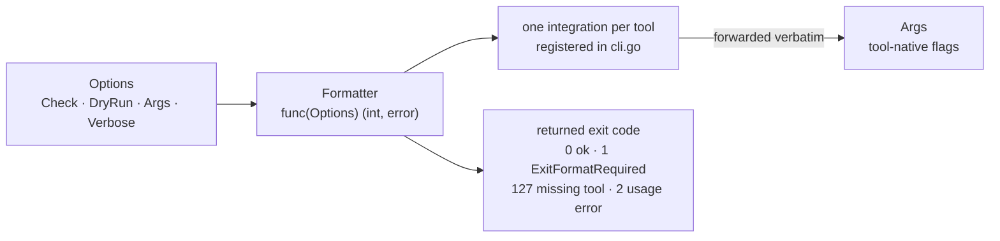

# Execution options and the Formatter contract (`formatter.go`)



`formatter.go` holds the two types every integration shares. It contains no logic of its own beyond the `Formatter` signature and the `withArgs` helper.

## `Options`

| Field     | Meaning                                                                                                                                                                                                                                      |
| --------- | -------------------------------------------------------------------------------------------------------------------------------------------------------------------------------------------------------------------------------------------- |
| `Check`   | Report violations without modifying files.                                                                                                                                                                                                   |
| `DryRun`  | Validate without modifying files (most tools alias this to their check mode; a few have no native check mode and synthesize one — see the integration docs, e.g. [mojo_format.go.md](mojo_format.go.md) and [odinfmt.go.md](odinfmt.go.md)). |
| `Args`    | Arguments forwarded verbatim to the underlying tool.                                                                                                                                                                                         |
| `Verbose` | Report the resolved executable on stderr.                                                                                                                                                                                                    |

## `Formatter`

```go
type Formatter func(Options) (int, error)
```

The returned integer is the process exit code the CLI reports. A non-nil error means the executable could not be resolved or started — the CLI turns that into exit `127`. Integrations that want "files need formatting" reported as exit `1` use the shared `ExitFormatRequired` value (defined in the CLI; see [cli.go.md](cli.go.md)); anything else passes through unchanged so meaningful upstream diagnostics survive.

`withArgs(prefix, args)` prefixes a tool's mandatory flags (for example gofmt's mode flag) in front of forwarded user arguments, always on a copy.

## Related pages

- [Command dispatch and the tool registry](cli.go.md)
- [Tool discovery, bundling, and shared subprocess helpers](tools.go.md)
- [AGENTS.md](../../AGENTS.md)
