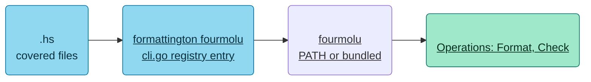

# Fourmolu (`fourmolu`)

Fourmolu (github.com/fourmolu/fourmolu) is a Haskell source code formatter. Formattington registers it for `.hs` files.

## At a glance

|                      |                                                                                                                                                                                                                                                |
| -------------------- | ---------------------------------------------------------------------------------------------------------------------------------------------------------------------------------------------------------------------------------------------- |
| Executable           | `fourmolu`                                                                                                                                                                                                                                     |
| Resolution           | Resolved from PATH or the bundled formatters (bundled for macOS arm64, macOS x86_64, Linux arm64, Linux x86_64; no Windows asset upstream, so Windows stays PATH-only; Linux builds are glibc-dynamic — musl/Alpine users need the PATH route) |
| Extensions           | `.hs`                                                                                                                                                                                                                                          |
| Operations           | Format, Check                                                                                                                                                                                                                                  |
| Language aliases     | `haskell` → `fourmolu`                                                                                                                                                                                                                         |
| Native configuration | `fourmolu.yaml` (walks up from each file); `--no-cabal` ignores `.cabal` files' `default-extensions`; `--config` forwarded verbatim (data-only)                                                                                                |

## Behavior

- Default invocation: `fourmolu --mode inplace` — format in place
- `--check`: `fourmolu --mode check` — print a unified diff to **stderr** and exit 100 when files need formatting
- `--dry-run`: same as `--check` (there is no separate diff mode)
- Forwarded arguments: forwarded verbatim to `fourmolu` (`--indentation`, `--config`, ...)
- Exit codes: exit 100 reported as `ExitFormatRequired` (1); 0 (clean), 101 (stdin/inplace conflict) and 102 (other failures) pass through verbatim, so the stderr diff is never swallowed

## Notes

- The check-mode unified diff is printed to **stderr**, not stdout — watch the right stream in scripts.
- Exit 100 is remapped to `ExitFormatRequired`; 102 and 101 are passed through verbatim as real failures.
- The full release archives bundle the four upstream binaries (macOS arm64, macOS x86_64, Linux arm64, Linux x86_64); Windows stays PATH-only via `ghcup install fourmolu` or `cabal install fourmolu`.
- Literate Haskell (`.lhs`) is not registered — the released parser rejects literate input, so only `.hs` is covered.
- Configuration is `fourmolu.yaml` discovered by walking up from each file; a caller-forwarded `--config` is honored verbatim.

## Related pages

- [Command dispatch and the tool registry](cli.go.md)
- [Tool discovery, bundling, and shared subprocess helpers](tools.go.md)
- [Execution options and the Formatter contract](formatter.go.md)
- [AGENTS.md](../../AGENTS.md)
- [README.md](../../README.md)
- Upstream: https://github.com/fourmolu/fourmolu
