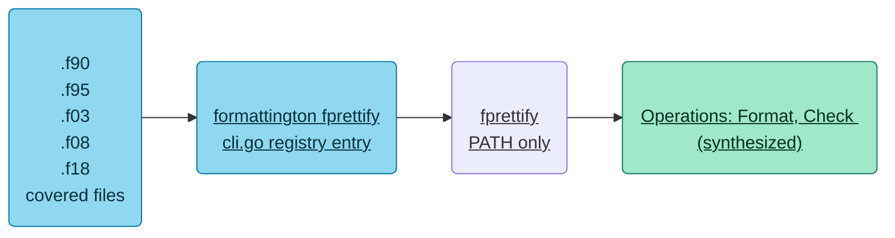

# fprettify (`fprettify`)

fprettify (github.com/pseewald/fprettify) is the de-facto Fortran free-form source formatter. Formattington registers it for `.f90`, `.f95`, `.f03`, `.f08`, and `.f18` files.

## At a glance

|                      |                                                                                                                            |
| -------------------- | -------------------------------------------------------------------------------------------------------------------------- |
| Executable           | `fprettify`                                                                                                                |
| Resolution           | PATH-only (never embedded — GPL-3.0+ and pure Python; install with `pipx install fprettify` / `pip install fprettify`)     |
| Extensions           | `.f90`, `.f95`, `.f03`, `.f08`, `.f18`                                                                                     |
| Operations           | Format, Check (synthesized)                                                                                                |
| Language aliases     | `fortran` → `fprettify`                                                                                                    |
| Native configuration | `-c`/`--config-file` selects a configuration file; `.fprettify.ini` / `setup.cfg` are discovered tool-natively (data-only) |

## Behavior

- Default invocation: `fprettify` — format in place
- `--check`: synthesized — `fprettify --diff` is run and its output is captured; non-empty diff output means files would be reformatted and is reported as `ExitFormatRequired` (1) (the diff itself is printed); empty output means clean
- `--dry-run`: `fprettify --diff` — print a diff, do not modify
- Forwarded arguments: forwarded verbatim to `fprettify` (`-c`/`--config-file` selects a configuration file)
- Exit codes: synthesized check reports non-empty diff output as `ExitFormatRequired` (1); a non-zero exit from the tool itself passes through untouched

## Notes

- fprettify is GPL-3.0+ and Python-based; it was deliberately rejected for bundling, so it must be installed separately.
- fprettify has no native check mode and its `--diff` output does not affect the exit code — Formattington synthesizes check mode from non-empty `--diff` output.
- Free-form Fortran only: `.f90`, `.f95`, `.f03`, `.f08`, `.f18`. Fixed-form `.f`/`.for` sources are not registered until fprettify's handling of them is verified.
- Configuration is tool-native (`.fprettify.ini` / `setup.cfg`); `-c`/`--config-file` selects a configuration file explicitly.
- `--dry-run` prints the diff without capturing; `--check` captures the diff to decide the exit code and prints it.

## Related pages

- [Command dispatch and the tool registry](cli.go.md)
- [Tool discovery, bundling, and shared subprocess helpers](tools.go.md)
- [Execution options and the Formatter contract](formatter.go.md)
- [AGENTS.md](../../AGENTS.md)
- [README.md](../../README.md)
- Upstream: https://github.com/pseewald/fprettify
