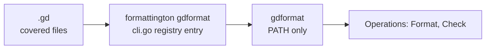

# gdformat (`gdformat`)

gdformat (github.com/Scony/godot-gdscript-toolkit) is the Godot 4 GDScript formatter, from the gdtoolkit Python package. Formattington registers it for `.gd` files.

## At a glance

|                      |                                                                                                 |
| -------------------- | ----------------------------------------------------------------------------------------------- |
| Executable           | `gdformat`                                                                                      |
| Resolution           | PATH-only (pure-Python package with no release binaries; on all six targets)                    |
| Extensions           | `.gd`                                                                                           |
| Operations           | Format, Check                                                                                   |
| Language aliases     | `gdscript` → `gdformat`                                                                         |
| Native configuration | `gdformatrc` / `.gdformatrc`, discovered by walking up from the working directory (tool-native) |

## Behavior

- Default invocation: `gdformat` — format in place
- `--check`: `gdformat -c` — print "would reformat <file>" and exit 1 when changes are needed, 0 otherwise
- `--dry-run`: `gdformat -d` — print a unified diff, do not modify (implies `--check`)
- Forwarded arguments: forwarded verbatim to `gdformat`
- Exit codes: no remapping — `-c`/`-d` exit 1 when reformatting is needed, as reported by the tool

## Notes

- Install with `pipx install gdtoolkit==4.*` for the Godot 4 line; gdtoolkit 3.x targets Godot 3. It is PATH-only because there are no release binaries.
- Formattington deliberately does not set `--fast`, so the safety checks (prologue/epilogue validation) stay on.
- `-d`/`--diff` prints a unified diff and implies `--check`.
- Configuration (`gdformatrc` / `.gdformatrc`) is discovered by walking up from the working directory and is tool-native.

## Related pages

- [Command dispatch and the tool registry](cli.go.md)
- [Tool discovery, bundling, and shared subprocess helpers](tools.go.md)
- [Execution options and the Formatter contract](formatter.go.md)
- [AGENTS.md](../../AGENTS.md)
- [README.md](../../README.md)
- Upstream: https://github.com/Scony/godot-gdscript-toolkit
