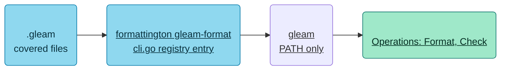

# gleam format (`gleam-format`)

`gleam format` is the Gleam language's built-in formatter, shipped with the Gleam toolchain. Formattington invokes the `gleam` binary with the `format` subcommand and registers the tool as `gleam-format`.

## At a glance

|                      |                                                    |
| -------------------- | -------------------------------------------------- |
| Executable           | `gleam` (via `gleam format`)                       |
| Resolution           | PATH-only (ships with the Gleam toolchain)         |
| Extensions           | `.gleam`                                           |
| Operations           | Format, Check                                      |
| Language aliases     | `gleam` → `gleam-format`                           |
| Native configuration | none by design (fixed style), and none is invented |

## Behavior

- Default invocation: `gleam format` — format in place
- `--check`: `gleam format --check <files...>` — print the files that would change and exit non-zero (`Error::Format`, i.e. 1) when any would
- `--dry-run`: same as `--check` (there is no diff mode)
- Forwarded arguments: forwarded verbatim to `gleam format`
- Exit codes: a non-zero exit in check mode (including `Error::Format` = 1) is reported as `ExitFormatRequired` (1); 0 means clean

## Notes

- The Formattington tool name is `gleam-format` (the binary is `gleam`; invoked as `gleam format`), and the `gleam` language alias resolves to it.
- There is no configuration by design — the style is fixed — and Formattington invents none.
- Install [Gleam](https://gleam.run/getting-started/installing-gleam/) for your platform (install script, Homebrew, Nix, or Cargo); `gleam format` ships with it.
- `--check` lists the files that would change; any non-zero exit from the check invocation is reported as `ExitFormatRequired`.

## Related pages

- [Command dispatch and the tool registry](cli.go.md)
- [Tool discovery, bundling, and shared subprocess helpers](tools.go.md)
- [Execution options and the Formatter contract](formatter.go.md)
- [AGENTS.md](../../AGENTS.md)
- [README.md](../../README.md)
- Upstream: https://github.com/gleam-lang/gleam
