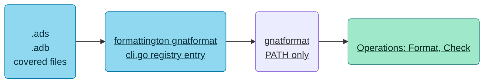

# GNATformat (`gnatformat`)

GNATformat (AdaCore/GNATformat) formats Ada source files; it is a port of the Prettier engine implementing the GNAT Coding Style. It covers `.ads` (specs) and `.adb` (bodies).

## At a glance

|                      |                                                                                                                                                      |
| -------------------- | ---------------------------------------------------------------------------------------------------------------------------------------------------- |
| Executable           | `gnatformat`                                                                                                                                         |
| Resolution           | PATH-only (ships with GNAT Pro, or via Alire `alr install gnatformat`, binary crate `gnatformat_bin`; no standalone release binary exists to bundle) |
| Extensions           | `.ads`, `.adb`                                                                                                                                       |
| Operations           | Format, Check                                                                                                                                        |
| Language aliases     | `ada` -> `gnatformat`                                                                                                                                |
| Native configuration | `.gpr` project file (options come from it; auto-loaded when exactly one exists in the cwd)                                                           |

## Behavior

- Default invocation: `gnatformat [--no-project] <files...>` — format in place. `--no-project` is passed when no `.gpr` exists in the cwd (unless you forwarded `--no-project` or `-P` yourself); when exactly one `.gpr` exists, the tool auto-loads it (tool-native behavior).
- `--check`: `gnatformat [--no-project] --check <files...>` — exit 1 when any file is not formatted (0 otherwise); files are not modified.
- `--dry-run`: same as `--check` (there is no built-in diff; `--pipe` prints the formatted source for your own `diff`).
- Forwarded arguments: verbatim; `--unparsing-configuration` selects a JSON configuration file. `--no-project` and `-P` suppress the automatic standalone-mode flag.
- Exit codes: no remapping (`--check` exit 1 is native); other codes pass through.

## Notes

- The `.gpr` project file is configuration, not formatted. When no `.gpr` exists in the working directory, Formattington passes `--no-project` so standalone files are formatted with built-in defaults.
- `.ads`/`.adb` are covered; the `.gpr` file itself is the configuration surface, not an input.
- The `.gpr` project file is **evaluated** configuration (it reads the environment and toolchain definitions at run time) — treat one shipped by an untrusted repository with care.
- `--check` exits 1 when files are not formatted.
- Apache-2.0 WITH LLVM-exception; PATH-only, never redistributed by Formattington.

## Related pages

- [Command dispatch and the tool registry](cli.go.md)
- [Tool discovery, bundling, and shared subprocess helpers](tools.go.md)
- [Execution options and the Formatter contract](formatter.go.md)
- [AGENTS.md](../../AGENTS.md)
- [README.md](../../README.md)
- Upstream: https://github.com/AdaCore/GNATformat
