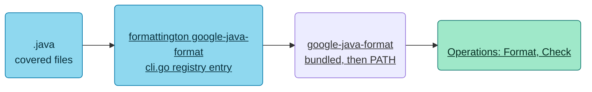

# google-java-format (`google-java-format`)

google-java-format formats Java source files. It covers `.java` files.

## At a glance

|                      |                                                                                                                                                       |
| -------------------- | ----------------------------------------------------------------------------------------------------------------------------------------------------- |
| Executable           | `google-java-format`                                                                                                                                  |
| Resolution           | Bundled (macOS arm64, Linux arm64/x86_64, Windows x86_64; no macOS x86_64 or Windows arm64 asset exists upstream — those stay PATH-only), then `PATH` |
| Extensions           | `.java`                                                                                                                                               |
| Operations           | Format, Check                                                                                                                                         |
| Language aliases     | `java` -> `google-java-format`                                                                                                                        |
| Native configuration | none (no configuration file by design; `--style=google\|aosp` is forwarded)                                                                           |

## Behavior

- Default invocation: `google-java-format --replace [--cleanup=false] <files...>` — format in place. Formattington passes `--cleanup=false` so diffs stay formatting-only (whitespace), unless you forward your own `--cleanup` value.
- `--check`: `google-java-format --dry-run --set-exit-if-changed [--cleanup=false] <files...>` — exit 1 when any file needs formatting; files are not modified.
- `--dry-run`: same as `--check` (there is no patch output).
- Forwarded arguments: verbatim — `--style=google|aosp`, a caller-provided `--cleanup` (which suppresses the injected `--cleanup=false`), and the all-deps jar route are all honored as given.
- Exit codes: no remapping (`--dry-run --set-exit-if-changed` exit 1 is native); other codes pass through.

## Notes

- google-java-format v2.0.0 enables a non-whitespace `--cleanup` pass (redundant semicolons and the like) by default; Formattington disables it (`--cleanup=false`) so diffs stay formatting-only unless you opt in with your own `--cleanup` flag.
- For macOS x86_64 and Windows arm64 there is no upstream native binary; use the all-deps jar on a JDK ≥ 21 with the six `--add-exports` flags (`jdk.compiler/com.sun.tools.javac.{api,code,file,parser,tree,util}=ALL-UNNAMED`).
- The bundled native binaries are redistributed unmodified; upstream has no macOS x86_64 or Windows arm64 asset.
- Apache-2.0.

## Related pages

- [Command dispatch and the tool registry](cli.go.md)
- [Tool discovery, bundling, and shared subprocess helpers](tools.go.md)
- [Execution options and the Formatter contract](formatter.go.md)
- [AGENTS.md](../../AGENTS.md)
- [README.md](../../README.md)
- Upstream: https://github.com/google/google-java-format
