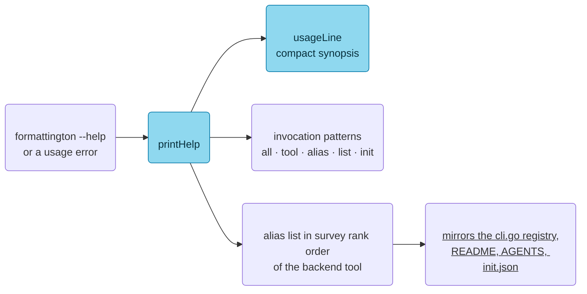

# Help output (`help.go`)

`help.go` renders the usage text printed for `formattington --help`, for unknown-argument usage errors (exit `2`), and the one-line `usage:` string.

## What it prints

`printHelp(out io.Writer)` (line ~143) writes the full help: the invocation patterns (`all`, specific tool, language alias, `list`, `init`), global options, per-tool notes for every registered tool, and the alias list.

The alias listing is not alphabetical — `sortedAliasNames` orders aliases by the registry position of their backend tool (the registry is in [survey order](../../AGENTS.md)); aliases sharing a backend are alphabetical, and tools with no survey row (markdownlint, taplo) sort last. `aliasRank` looks the backend up in the registry-derived index. The epilog (`helpEpilog`) carries the same per-tool guidance users need without reading the source, in the same presentation order as the registry.

`usageLine` is the compact synopsis reused by usage-error paths.

## Keeping it accurate

The help text, the registry order in [cli.go](cli.go.md), the hardcoded order lists in [README.md](../../README.md), [AGENTS.md](../../AGENTS.md), and the embedded catalogue [init.json](init.go.md) all mirror one another by convention — see `template_test.go` for the round-trip validation of the catalogue.

## Related pages

- [Command dispatch and the tool registry](cli.go.md)
- [AGENTS.md](../../AGENTS.md)
