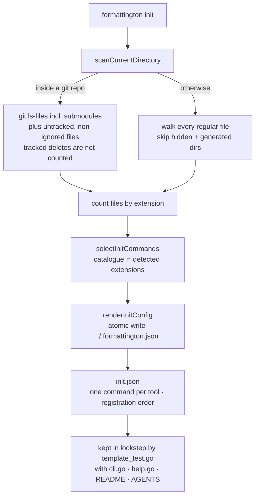

# The `init` command and its embedded catalogue (`init.go`, `init.json`)

`formattington init` examines the current directory and writes `./.formattington.json` with the formatter invocations for the file types present — without file arguments, so discovery behaves as usual.

## The scan

`runInit` (line ~50) orchestrates; `scanCurrentDirectory` (line ~113) chooses the strategy:

- Inside a Git repository, `scanRepo` (line ~136) prefers `git ls-files` (including submodules) plus untracked, non-ignored files (`scanGitList`, `scanUntracked`, `scanSubmoduleUntracked`), falling back to a manifest-free filesystem walk (`walkFiles`, line ~248) when Git is unavailable (`gitAvailable`, line ~324). Tracked files deleted from the working tree are not counted; a nested repository encountered during the scan is examined from its own tracked perspective.
- Everywhere else, `walkFiles` examines every regular file. Hidden directories and the usual generated/vendored/package-manager directory names are always skipped, and files are only counted by extension.

## The embedded catalogue

`init.json` is the embedded catalogue `init` draws from — one command per registered tool, in registration order. It is validated and round-tripped by `template_test.go`, which also keeps it in lockstep with the registry in [cli.go](cli.go.md), the hardcoded order lists in [help.go.md](help.go.md), [README.md](../../README.md), and [AGENTS.md](../../AGENTS.md). Edit the catalogue and those lists together, never one alone.

`selectInitCommands` (line ~366) keeps the catalogue entries for the tools whose extensions were detected; `renderInitConfig` (line ~391) renders the final JSON, which is then atomically written to `./.formattington.json`.

## Confirmation and refusal

If `./.formattington.json` already exists, `init` asks for confirmation first (`y`/`yes` overwrites; `confirmOverwrite`, line ~419). A non-interactive shell refuses without modifying the file (`stdinIsTerminal`, line ~433).

`init` takes no arguments or mode flags — `--check`/`--dry-run`/`--series`/`--config` are usage errors (exit `2`). It prints `Examining current directory... found N files across M file extensions.` and exits `0` on success (`2` on usage errors or refusal to overwrite).

## Related pages

- [Configuration file loading (`.formattington.json`)](config.go.md)
- [Command dispatch and the tool registry](cli.go.md)
- [README.md](../../README.md)
