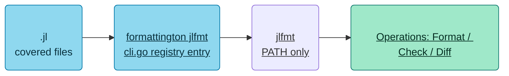

# jlfmt (`jlfmt`)

jlfmt is the Julia formatter, distributed as a Julia app from JuliaFormatter.jl (installed via `Pkg.Apps.add`). The integration handles `.jl` files; the `julia` language alias resolves to `jlfmt`.

## At a glance

|                      |                                                                                                                   |
| -------------------- | ----------------------------------------------------------------------------------------------------------------- |
| Executable           | `jlfmt` (Julia app executable on PATH)                                                                            |
| Resolution           | PATH-only — Julia is ~600 MB installed, a bundle was never on the table; Windows on ARM has no Julia build at all |
| Extensions           | `.jl`                                                                                                             |
| Operations           | Format / Check / Diff                                                                                             |
| Language aliases     | `julia` → `jlfmt`                                                                                                 |
| Native configuration | `.JuliaFormatter.toml`, discovered by walking up from each file                                                   |

## Behavior

- Default invocation: `jlfmt --inplace` against the target file(s), formatting in place.
- `--check`: `jlfmt --check`; exit `1` reports files needing formatting (reported as `ExitFormatRequired`); exit `2` (error) passes through verbatim.
- `--dry-run`: `jlfmt --diff` — a unified diff computed with `git --no-index`, so it requires git on PATH; when git is absent the integration prints a note on stderr and runs `--check` instead.
- Forwarded arguments: passed verbatim; `.JuliaFormatter.toml` discovery is unaffected.
- Exit codes: `--check` exit `1` is remapped to `ExitFormatRequired`; all other codes pass through.

## Notes

- Requires Julia >= 1.12 on PATH — `Pkg.Apps` only exists there. Install with `julia -e 'using Pkg; Pkg.Apps.add("JuliaFormatter")'`. A plain `Pkg.add` does not put `jlfmt` on PATH; the app install does.
- `--diff` shells out to `git --no-index`; without git the integration degrades to `--check` with a clear note rather than failing.
- `.JuliaFormatter.toml` is discovered by walking up from each file, independently of any taplo/TOML tooling you run alongside.

## Related pages

- [Command dispatch and the tool registry](cli.go.md)
- [Tool discovery, bundling, and shared subprocess helpers](tools.go.md)
- [Execution options and the Formatter contract](formatter.go.md)
- [AGENTS.md](../../AGENTS.md)
- [README.md](../../README.md)
- Upstream: https://github.com/JuliaEditorSupport/JuliaFormatter.jl
