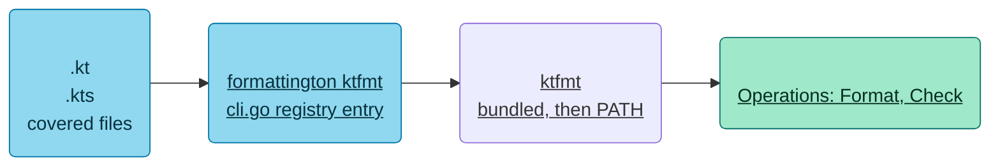

# ktfmt (`ktfmt`)

ktfmt formats Kotlin source files (github.com/Kotlin/ktfmt). It covers `.kt` and `.kts` files.

## At a glance

|                      |                                                                                                                                                               |
| -------------------- | ------------------------------------------------------------------------------------------------------------------------------------------------------------- |
| Executable           | `ktfmt`                                                                                                                                                       |
| Resolution           | Bundled (Linux x86_64, macOS arm64, Windows x86_64; no Linux arm64, macOS x86_64, or Windows arm64 asset exists upstream — those stay PATH-only), then `PATH` |
| Extensions           | `.kt`, `.kts`                                                                                                                                                 |
| Operations           | Format, Check                                                                                                                                                 |
| Language aliases     | `kotlin` -> `ktfmt`                                                                                                                                           |
| Native configuration | none (no configuration file by design; `.editorconfig` is honored only with `--enable-editorconfig`)                                                          |

## Behavior

- Default invocation: `ktfmt <files...>` — format in place.
- `--check`: `ktfmt --dry-run --set-exit-if-changed <files...>` — exit 1 when any file would change; files are not modified.
- `--dry-run`: `ktfmt --dry-run <files...>` — list files that would change; upstream always exits 0 here (NOT a usable check).
- Forwarded arguments: verbatim; no style flag is ever injected — `--google-style` / `--kotlinlang-style` / `--meta-style` (the upstream default is `--kotlinlang-style`) are passed as given.
- Exit codes: no remapping (`--set-exit-if-changed` exit 1 is native); other codes pass through.

## Notes

- A bare `--dry-run` prints the files that would change but always exits 0, so it is not a usable check; `--check` fails the build via `--set-exit-if-changed` instead.
- ktfmt has no configuration file by design; `.editorconfig` is honored only when `--enable-editorconfig` is passed.
- Linux x86_64, macOS arm64, and Windows x86_64 bundles ship in the full release archives; other platforms stay PATH-only (PATH installs may use the with-dependencies jar, JDK 11+).
- Apache-2.0.

## Related pages

- [Command dispatch and the tool registry](cli.go.md)
- [Tool discovery, bundling, and shared subprocess helpers](tools.go.md)
- [Execution options and the Formatter contract](formatter.go.md)
- [AGENTS.md](../../AGENTS.md)
- [README.md](../../README.md)
- Upstream: https://github.com/Kotlin/ktfmt
