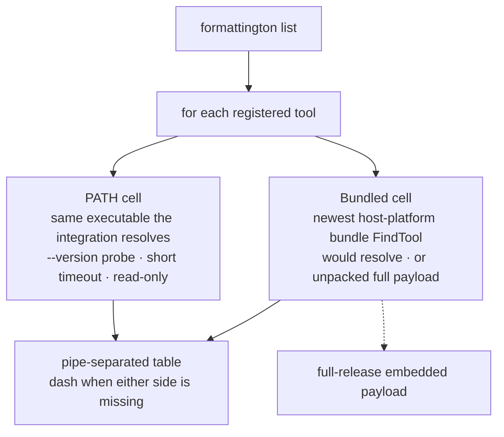

# The `list` command (`list.go`)

`formattington list` prints a pipe-separated table of every registered tool with its **Bundled** and **PATH** versions — the `-` placeholder means either side does not exist.

## How versions are probed

For each registered tool, `printList` (line ~178) reports two cells:

- **Bundled** — the newest host-platform bundle `FindTool` would resolve from `FormattersDir()` (see [tools.go.md](tools.go.md)), or the payload embedded in a `full` build unpacked on first use (see [embedded.go.md](embedded.go.md)).
- **PATH** — the same executable the integration resolves, probed at list time. Most tools answer `--version`; `gofmt`/`goimports` are probed via `go version <path>`, `zig` via `zig version`, `dotnet` via `dotnet format --version`, and `Rscript` for the installed styler package version. Probes run under a short timeout and never modify files; a missing executable or undeterminable version prints `-`.

`candidatesFor` (line ~80), `firstVersion` (line ~95), `outputWithTimeout` (line ~102), and `probeCandidate` (line ~115) implement the probing ladder; `bundledVersionFor`/`pathVersionFor` map each tool name onto its probe recipe (the bundled side reuses the shared `findBundledForHost` from tools.go).

`list` takes no arguments or mode flags — `--check`/`--dry-run`/`--series`/`--config` are usage errors (exit `2`) — and exits `0`.

## Related pages

- [Command dispatch and the tool registry](cli.go.md)
- [Tool discovery, bundling, and shared subprocess helpers](tools.go.md)
