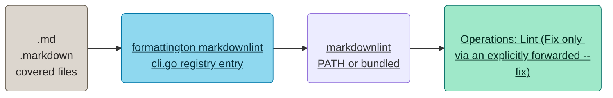

# markdownlint (`markdownlint`)

markdownlint runs `markdownlint-cli` to lint Markdown files for style and consistency. It covers `.md` and `.markdown` files and is read-only unless you pass `--fix`.

## At a glance

|                      |                                                                                                         |
| -------------------- | ------------------------------------------------------------------------------------------------------- |
| Executable           | `markdownlint` (markdownlint-cli)                                                                       |
| Resolution           | Resolved from PATH or the bundled formatters (bundled in the full release archives)                     |
| Extensions           | `.md`, `.markdown`                                                                                      |
| Operations           | Lint (Fix only via an explicitly forwarded `--fix`)                                                     |
| Language aliases     | none (invoke it as `markdownlint`)                                                                      |
| Native configuration | `.markdownlint.json` / `.yaml` / `.yml` (and other markdownlint-cli configuration), discovered natively |

## Behavior

- Default invocation: `markdownlint <files...>` verbatim — lint only; findings exit 1, no findings exit 0. The tool never rewrites files without an explicit `--fix`.
- `--check`: same invocation (accepted for CLI uniformity; does not change the lint).
- `--dry-run`: same invocation (accepted for CLI uniformity; does not change the lint).
- Forwarded arguments: verbatim, so `--fix`, `--config`, and glob patterns all work natively; with no file arguments, matching Markdown files are discovered recursively.
- Exit codes: no remapping (findings exit 1 natively); other codes pass through.

## Notes

- `markdownlint --fix` can automatically correct certain Markdown violations but cannot resolve every linting issue; `--fix` rewrites files only when explicitly passed.
- There is no language alias: use `md`/`markdown` (Prettier) for Markdown formatting and `markdownlint` for Markdown linting — the two are complementary, and a file can be correctly formatted while still containing lint violations.
- Configuration (for example `.markdownlint.json`) is discovered by the tool itself and needs no Formattington-side setup.
- In `all`, `markdownlint` runs like every other registered tool (registered in survey order); findings exit 1.
- MIT (markdownlint-cli); bundled in the full release archives.

## Related pages

- [Command dispatch and the tool registry](cli.go.md)
- [Tool discovery, bundling, and shared subprocess helpers](tools.go.md)
- [Execution options and the Formatter contract](formatter.go.md)
- [AGENTS.md](../../AGENTS.md)
- [README.md](../../README.md)
- Upstream: https://github.com/igorshubovych/markdownlint-cli
