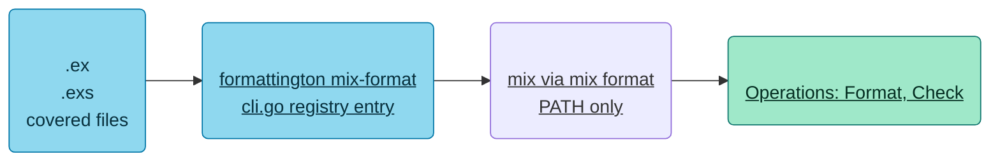

# mix format (`mix-format`)

mix format is Elixir's built-in formatter; it ships with the Elixir installation and covers `.ex` and `.exs` files. The tool name is `mix-format` — the bare binary is `mix`, invoked as `mix format`.

## At a glance

|                      |                                                                                                                                                 |
| -------------------- | ----------------------------------------------------------------------------------------------------------------------------------------------- |
| Executable           | `mix` via `mix format`                                                                                                                          |
| Resolution           | PATH-only (ships with Elixir; needs Erlang/OTP on `PATH`)                                                                                       |
| Extensions           | `.ex`, `.exs`                                                                                                                                   |
| Operations           | Format, Check                                                                                                                                   |
| Language aliases     | `elixir` -> `mix-format`                                                                                                                        |
| Native configuration | `.formatter.exs` (**executed code** — returns a keyword list of formatter inputs/plugins; discovered from the current directory, not walked up) |

## Behavior

- Default invocation: `mix format --no-compile <files...>` — format in place with formatter plugins skipped so formatting never compiles the project.
- `--check`: `mix format --check-formatted --no-compile <files...>` — exit non-zero when any file would change; files are not modified.
- `--dry-run`: same as `--check` (never writes; there is no diff mode).
- Forwarded arguments: verbatim — for example, drop `--no-compile` yourself (or set formatter plugins in `.formatter.exs`) when plugins are required.
- Exit codes: any non-zero exit from `--check-formatted` is reported as `ExitFormatRequired` (1); other codes pass through.

## Notes

- **`.formatter.exs` is EXECUTED CODE** (returns a keyword list: inputs, plugins, import_deps, ...), discovered from the CURRENT DIRECTORY — never run this against untrusted projects. "Check mode" is not a sandbox.
- The tool name is `mix-format`, not `mix`, to avoid colliding with the build tool's own command shape.
- Formatter output can change between Elixir versions.
- `--no-compile` is passed by default so formatting never compiles the project; pass `--no-compile`-free arguments yourself when plugins are needed.
- Apache-2.0; PATH-only, never redistributed by Formattington.

## Related pages

- [Command dispatch and the tool registry](cli.go.md)
- [Tool discovery, bundling, and shared subprocess helpers](tools.go.md)
- [Execution options and the Formatter contract](formatter.go.md)
- [AGENTS.md](../../AGENTS.md)
- [README.md](../../README.md)
- Upstream: https://github.com/elixir-lang/elixir
