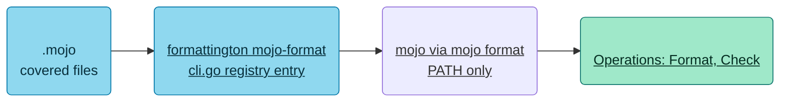

# mojo format (`mojo-format`)

mojo format is the formatter built into the Mojo toolchain (Modular). It covers `.mojo` files. The tool name is `mojo-format` — the bare binary is `mojo`, invoked as `mojo format`.

## At a glance

|                      |                                                                                                |
| -------------------- | ---------------------------------------------------------------------------------------------- |
| Executable           | `mojo` via `mojo format`                                                                       |
| Resolution           | PATH-only (Linux glibc ≥ 2.34, x86-64-v3 / Neoverse N1+; macOS Apple silicon; Windows via WSL) |
| Extensions           | `.mojo`                                                                                        |
| Operations           | Format, Check                                                                                  |
| Language aliases     | `mojo` -> `mojo-format`                                                                        |
| Native configuration | none (no configuration file exists, and none is invented)                                      |

## Behavior

- Default invocation: `mojo format [flags] <files...>` — format in place. There is no check mode upstream.
- `--check`: synthesized — each file is copied into a temporary directory, the copies are formatted there, and the copies are byte-compared against the originals; exit 1 when any file differs. The user tree is never modified. Differing files are reported on stderr.
- `--dry-run`: same synthesis as `--check` (no diff mode exists).
- Forwarded arguments: verbatim (for example `-l <N>` / `--line-length <N>`, `-q`); applied to the copies in check mode just as they would be in place in default mode.
- Exit codes: the synthesized check reports `ExitFormatRequired` (1) when any file differs; non-zero exits from the tool itself pass through verbatim.

## Notes

- **There is no check mode upstream** — Formattington synthesizes one by copying each file to a temp dir, formatting the copies, and byte-comparing. The same synthesis backs `--dry-run`.
- **Platform support is narrow: Linux glibc ≥ 2.34 (x86-64-v3 / Neoverse N1+) and macOS Apple silicon only; Windows requires WSL.**
- Arguments such as `-l`/`--line-length` are forwarded verbatim; `-l`/`--line-length` are recognized as value-taking flags when splitting args from files.
- There is no configuration file, and none is invented.
- Apache-2.0 WITH LLVM-exception (compiler portions); some MAX components under the Modular MAX License; PATH-only.

## Related pages

- [Command dispatch and the tool registry](cli.go.md)
- [Tool discovery, bundling, and shared subprocess helpers](tools.go.md)
- [Execution options and the Formatter contract](formatter.go.md)
- [AGENTS.md](../../AGENTS.md)
- [README.md](../../README.md)
- Upstream: https://github.com/modular/mojo
