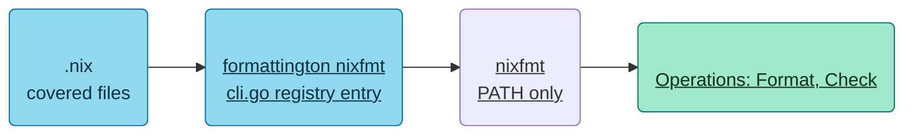

# nixfmt (`nixfmt`)

nixfmt is the official Nix formatter (RFC 166, "rfc style"). It covers `.nix` files.

## At a glance

|                      |                                                                                                                                  |
| -------------------- | -------------------------------------------------------------------------------------------------------------------------------- |
| Executable           | `nixfmt`                                                                                                                         |
| Resolution           | PATH-only (install via Nix `nixpkgs.nixfmt-rfc-style` or `brew install nixfmt`; upstream publishes no bundleable release matrix) |
| Extensions           | `.nix`                                                                                                                           |
| Operations           | Format, Check                                                                                                                    |
| Language aliases     | `nix` -> `nixfmt`                                                                                                                |
| Native configuration | none (no configuration file; `--width`/`--indent` exist as flags only)                                                           |

## Behavior

- Default invocation: `nixfmt <files...>` — format in place.
- `--check`: `nixfmt --check <files...>` — exit 1 when any file is not formatted (exit 1 is also reported on parse errors, indistinguishable from formatting findings; stderr disambiguates).
- `--dry-run`: same as `--check` (no diff mode exists; validate without modifying files).
- Forwarded arguments: verbatim (for example `--width`/`--indent`).
- Exit codes: no remapping (`--check` exit 1 is native); other codes pass through.

## Notes

- `--check` exit 1 is used both for formatting findings and parse errors — stderr disambiguates the two.
- nixfmt takes no configuration file; the width and indent settings are flags only (`--width`, `--indent`).
- nixfmt is PATH-only; upstream publishes no bundleable release matrix.
- MPL-2.0; PATH-only, never redistributed by Formattington.

## Related pages

- [Command dispatch and the tool registry](cli.go.md)
- [Tool discovery, bundling, and shared subprocess helpers](tools.go.md)
- [Execution options and the Formatter contract](formatter.go.md)
- [AGENTS.md](../../AGENTS.md)
- [README.md](../../README.md)
- Upstream: https://github.com/NixOS/nixfmt
