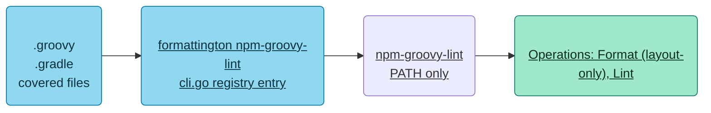

# npm-groovy-lint (`npm-groovy-lint`)

npm-groovy-lint is the only viable Groovy formatter (Spotless is a Gradle/Maven build plugin with no standalone CLI; Apache Groovy ships no formatter). It covers `.groovy` and `.gradle` files.

## At a glance

|                      |                                                                                                                            |
| -------------------- | -------------------------------------------------------------------------------------------------------------------------- |
| Executable           | `npm-groovy-lint`                                                                                                          |
| Resolution           | PATH-only (`npm install -g npm-groovy-lint`; needs Node >= 18 and Java 11+ on `PATH`)                                      |
| Extensions           | `.groovy`, `.gradle`                                                                                                       |
| Operations           | Format (layout-only), Lint                                                                                                 |
| Language aliases     | `groovy` -> `npm-groovy-lint`                                                                                              |
| Native configuration | `.groovylintrc` (`.js`/`.cjs`/`.json`/`.yml`, via cosmiconfig) or `package.json`; `-c` forwarded to point at a config file |

## Behavior

- Default invocation: `npm-groovy-lint --format <files...>` — format in place (layout rules only).
- `--check`: `npm-groovy-lint --failon error <files...>` — linter-flavored check: no writes, exit 1 at the error threshold. NOT a byte comparison.
- `--dry-run`: same as `--check` (no diff mode exists).
- Forwarded arguments: verbatim; `.groovylintrc.js/.json/.yml` discovery is tool-native, or pass `-c <path>` yourself.
- Exit codes: no remapping (findings at or above the `--failon` threshold exit 1 natively); other codes pass through.

## Notes

- **Layout-only** — it fixes indentation/brace spacing/blank lines and never re-breaks long lines.
- Requires **Node >= 18 and Java 11+** on `PATH` (a long-lived Java microservice backs the analysis; `--noserver` disables it).
- For any layout findings to be reported, the project's `.groovylintrc` must enable the `format` preset (for example `extends: ["recommended", "format"]`); current versions do not report layout by default.
- Check mode is linter-flavored, not a byte comparison: the tool reports layout rule violations at or above `--failon` and exits 1 at the threshold.
- `Jenkinsfile` (extensionless) is out of scope for discovery — pass it explicitly or via a config command. Jenkins pipelines and Gradle `.gradle` files are covered (the `.gradle` extension is registered).
- MIT; PATH-only, never redistributed by Formattington.

## Related pages

- [Command dispatch and the tool registry](cli.go.md)
- [Tool discovery, bundling, and shared subprocess helpers](tools.go.md)
- [Execution options and the Formatter contract](formatter.go.md)
- [AGENTS.md](../../AGENTS.md)
- [README.md](../../README.md)
- Upstream: https://github.com/nvuillam/npm-groovy-lint
