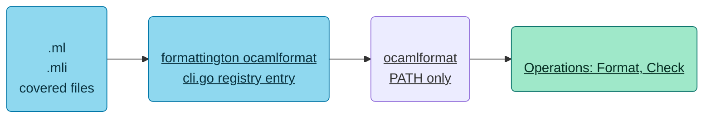

# ocamlformat (`ocamlformat`)

ocamlformat formats OCaml source files. It covers `.ml` and `.mli` files.

## At a glance

|                      |                                                                                                                                  |
| -------------------- | -------------------------------------------------------------------------------------------------------------------------------- |
| Executable           | `ocamlformat`                                                                                                                    |
| Resolution           | PATH-only (`opam install ocamlformat`; ships only as opam source built against your switch — no native binaries exist to bundle) |
| Extensions           | `.ml`, `.mli`                                                                                                                    |
| Operations           | Format, Check                                                                                                                    |
| Language aliases     | `ocaml` -> `ocamlformat`                                                                                                         |
| Native configuration | `.ocamlformat` (requires a `version = <installed release>` line); `.ocamlformat-ignore` also exists                              |

## Behavior

- Default invocation: `ocamlformat --inplace <files...>` — format in place.
- `--check`: `ocamlformat --check <files...>` — exit 1 when any file needs formatting (exit 1 is also used for errors, indistinguishable — stderr disambiguates); files are not modified.
- `--dry-run`: same as `--check` (no diff mode exists; validate without modifying files).
- Forwarded arguments: verbatim (for example `--profile`, `--enable-outside-detected-project`).
- Exit codes: exit 1 (formatting needed or error) is reported as `ExitFormatRequired` (1); stderr disambiguates the two. Other codes pass through.

## Notes

- **The `.ocamlformat` file requires a `version = <installed release>` line** and the tool refuses to run on a mismatch — a common failure mode; pin `version =` to the release you have installed (or run `dune build`, which pins it).
- `--check` exit 1 means formatting needed _or_ error (indistinguishable — stderr disambiguates).
- `.ocamlformat-ignore` exists for excluding files from formatting.
- `dune fmt` wraps ocamlformat for dune projects.
- MIT; PATH-only, never redistributed by Formattington.

## Related pages

- [Command dispatch and the tool registry](cli.go.md)
- [Tool discovery, bundling, and shared subprocess helpers](tools.go.md)
- [Execution options and the Formatter contract](formatter.go.md)
- [AGENTS.md](../../AGENTS.md)
- [README.md](../../README.md)
- Upstream: https://github.com/ocaml-ppx/ocamlformat
