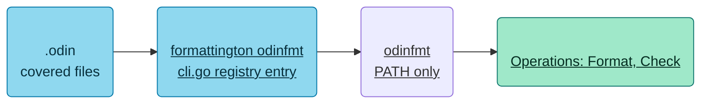

# odinfmt (`odinfmt`)

odinfmt formats Odin source files. It ships only as part of the Odin Language Server (`DanielGavin/ols`, community-maintained, not officially blessed by odin-lang) and covers `.odin` files.

## At a glance

|                      |                                                                                                     |
| -------------------- | --------------------------------------------------------------------------------------------------- |
| Executable           | `odinfmt`                                                                                           |
| Resolution           | PATH-only (`brew install odinfmt` or build from ols source; no release binaries, no Windows binary) |
| Extensions           | `.odin`                                                                                             |
| Operations           | Format, Check                                                                                       |
| Language aliases     | `odin` -> `odinfmt`                                                                                 |
| Native configuration | `odinfmt.json` (discovered by walking up from each file; `--config` overrides)                      |

## Behavior

- Default invocation: `odinfmt -w <files...>` — format in place; **`-w` creates an `<file>_bk` backup** before replacing the file.
- `--check`: synthesized — `odinfmt <file>` is run once per file and stdout is byte-compared with the original; exit 1 when any file would change. The user tree is never modified. Differing files are reported on stderr.
- `--dry-run`: same synthesis as `--check` (no diff mode exists).
- Forwarded arguments: verbatim; `--config <path>` overrides `odinfmt.json` discovery.
- Exit codes: the synthesized check reports `ExitFormatRequired` (1) when any file differs; tool errors pass through verbatim.

## Notes

- **`-w` creates an `<file>_bk` backup** before replacing the file — add `*_bk` to your ignore rules.
- There is no check mode upstream; check mode is synthesized by byte-comparing `odinfmt <file>` stdout against the original (tree untouched; one process per file, because stdout mode cannot delimit multiple files).
- `odinfmt.json` is discovered by walking up from the target (`--config` overrides).
- Distributed via Homebrew and nixpkgs; there is no Windows binary at all.
- MIT; PATH-only, never redistributed by Formattington.

## Related pages

- [Command dispatch and the tool registry](cli.go.md)
- [Tool discovery, bundling, and shared subprocess helpers](tools.go.md)
- [Execution options and the Formatter contract](formatter.go.md)
- [AGENTS.md](../../AGENTS.md)
- [README.md](../../README.md)
- Upstream: https://github.com/DanielGavin/ols
