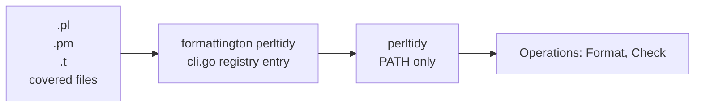

# perltidy (`perltidy`)

perltidy is the Perl formatter. It covers `.pl`, `.pm`, and `.t` files. It is GPL-2.0+ and is never embedded into the release binaries; it requires `perl` on `PATH` (on Windows, install Strawberry Perl).

## At a glance

|                      |                                                                               |
| -------------------- | ----------------------------------------------------------------------------- |
| Executable           | `perltidy`                                                                    |
| Resolution           | PATH-only (`cpan Perl::Tidy` or your package manager; needs `perl` on `PATH`) |
| Extensions           | `.pl`, `.pm`, `.t`                                                            |
| Operations           | Format, Check                                                                 |
| Language aliases     | `perl` -> `perltidy`                                                          |
| Native configuration | `.perltidyrc` (**executed code** — Perl), discovered by the tool itself       |

## Behavior

- Default invocation: `perltidy -b -bext=/ <files...>` — format in place; `-b` writes backups but `-bext=/` suppresses the `.bak` files perltidy would otherwise leave next to every formatted file.
- `--check`: `perltidy --assert-tidy <files...>` — exit 0 when the input is tidy; any non-zero code is reported as `ExitFormatRequired` (1) with stderr preserved. Files are not modified.
- `--dry-run`: `perltidy -d <files...>` — print a diff, do not modify files.
- Forwarded arguments: verbatim (for example `--profile=path`, `--noprofile`, `-i=4`).
- Exit codes: any non-zero exit from `--assert-tidy` is reported as `ExitFormatRequired` (1). Very old perltidy releases without `--assert-tidy` fail with a usage error, which is also reported as `ExitFormatRequired` (1); the manual recipe is `perltidy -st file | diff - file`.

## Notes

- The default mode suppresses `.bak` files with `-bext=/`; without it perltidy leaves a `.bak` next to every formatted file.
- **`.perltidyrc` is executed code** (Perl) — treat one shipped by an untrusted repository with care.
- GPL-2.0+ and never embedded into the release binaries; needs `perl` on `PATH` (on Windows, install Strawberry Perl).
- perltidy discovers `.perltidyrc` itself; `--profile=path` / `--noprofile` override it.

## Related pages

- [Command dispatch and the tool registry](cli.go.md)
- [Tool discovery, bundling, and shared subprocess helpers](tools.go.md)
- [Execution options and the Formatter contract](formatter.go.md)
- [AGENTS.md](../../AGENTS.md)
- [README.md](../../README.md)
- Upstream: https://github.com/perltidy/perltidy
