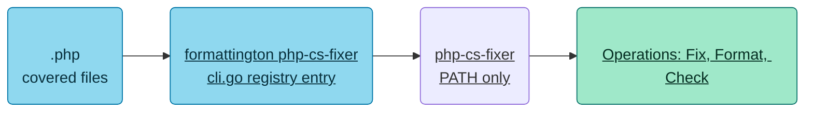

# PHP-CS-Fixer (`php-cs-fixer`)

PHP-CS-Fixer is the de-facto PHP fixer, covering `.php` files. It is integrated through its subcommands (`fix`, `check`) rather than any Formattington-specific logic.

## At a glance

|                      |                                                     |
| -------------------- | --------------------------------------------------- |
| Executable           | `php-cs-fixer`                                      |
| Resolution           | PATH-only (needs a PHP ≥ 7.4 interpreter on `PATH`) |
| Extensions           | `.php`                                              |
| Operations           | Fix, Format, Check                                  |
| Language aliases     | `php` -> `php-cs-fixer`                             |
| Native configuration | `.php-cs-fixer.php` / `.php-cs-fixer.dist.php`      |

## Behavior

- Default invocation: `php-cs-fixer fix` — fix in place.
- `--check`: `php-cs-fixer check` — fail if any file needs fixing; files are not modified.
- `--dry-run`: same as `--check` (non-modifying; `check` is shorthand for `fix --dry-run`).
- Forwarded arguments: verbatim after the subcommand; `--config=path` overrides the discovered configuration.
- Exit codes: native exit 8 (files need fixing) is reported as `ExitFormatRequired` (1); all other codes pass through untouched.

## Notes

- `php-cs-fixer check` is shorthand for `fix --dry-run`; its native exit code 8 is remapped to `ExitFormatRequired`.
- Configuration (`.php-cs-fixer.php` / `.php-cs-fixer.dist.php`) is discovered by the tool itself in the current directory and can be overridden with `--config=path`.
- `.php-cs-fixer.php` / `.php-cs-fixer.dist.php` are **executed code** (PHP) — see the untrusted-repositories guidance in [README.md](../../README.md).
- Install with `composer global require friendsofphp/php-cs-fixer` or `brew install php-cs-fixer`.
- PHP-CS-Fixer has no genuine check mode other tools agree on, so `--dry-run` maps to the same non-modifying `check` invocation as `--check`.

## Related pages

- [Command dispatch and the tool registry](cli.go.md)
- [Tool discovery, bundling, and shared subprocess helpers](tools.go.md)
- [Execution options and the Formatter contract](formatter.go.md)
- [AGENTS.md](../../AGENTS.md)
- [README.md](../../README.md)
- Upstream: https://github.com/PHP-CS-Fixer/PHP-CS-Fixer
