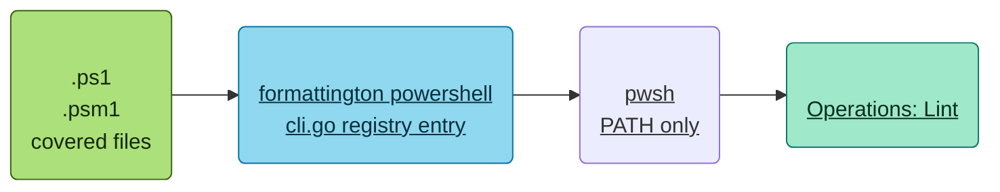

# PSScriptAnalyzer (`powershell`)

PowerShell integration: lints `.ps1` and `.psm1` files with [PSScriptAnalyzer](https://github.com/PowerShell/PSScriptAnalyzer) through PowerShell, rather than formatting them. There is no in-place formatting; every mode is a read-only lint.

## At a glance

|                      |                                                                                                                        |
| -------------------- | ---------------------------------------------------------------------------------------------------------------------- |
| Executable           | `pwsh` (PowerShell 7+), falling back to `powershell` (Windows PowerShell 5.1); invoked as `pwsh -NoProfile -Command …` |
| Resolution           | PATH-only (PSScriptAnalyzer is a module; nothing is bundled)                                                           |
| Extensions           | `.ps1`, `.psm1`                                                                                                        |
| Operations           | Lint                                                                                                                   |
| Language aliases     | `ps1` -> `powershell`                                                                                                  |
| Native configuration | `PSScriptAnalyzerSettings.psd1` (read via `Import-PowerShellDataFile`)                                                 |

## Behavior

- Default invocation: PSScriptAnalyzer lint via `Invoke-ScriptAnalyzer` — findings exit 1; files are never rewritten.
- `--check`: same lint invocation (accepted for CLI uniformity; it does not change anything).
- `--dry-run`: same as `--check`.
- Forwarded arguments: `.ps1`/`.psm1`-suffixed tokens are treated as files (passed via `-Path`); any other token becomes an `Invoke-ScriptAnalyzer` parameter, so e.g. `formattington ps1 -Severity Error` forwards `-Severity Error`. With no files, the current directory is analyzed recursively.
- Exit codes: no remapping; findings exit 1, no findings exit 0.

## Notes

- PowerShell 7+ (`pwsh`) is required for PSScriptAnalyzer; on Windows the in-box Windows PowerShell (`powershell.exe`) is tried as a fallback.
- PSScriptAnalyzer must be installed inside the shell with `Install-Module PSScriptAnalyzer`; `pwsh` is tried first, then `powershell`.
- The lint runs through `pwsh -NoProfile -Command …`; the module is imported with `-ErrorAction Stop`.
- Formattington never injects analyzer settings; configuration, if any, is discovered natively by the tool.
- A missing or failing analyzer is reported like any other tool failure; a missing shell is exit 127.

## Related pages

- [Command dispatch and the tool registry](cli.go.md)
- [Tool discovery, bundling, and shared subprocess helpers](tools.go.md)
- [Execution options and the Formatter contract](formatter.go.md)
- [AGENTS.md](../../AGENTS.md)
- [README.md](../../README.md)
- Upstream: https://github.com/PowerShell/PSScriptAnalyzer
