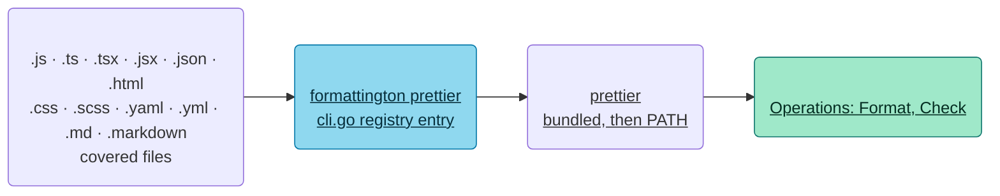

# Prettier (`prettier`)

Prettier is the JavaScript/TypeScript-family formatter covering JS, TS, JSX/TSX, JSON, HTML, CSS/SCSS, YAML, and Markdown. It is the sole owner of Markdown formatting in Formattington.

## At a glance

|                      |                                                                                                                                        |
| -------------------- | -------------------------------------------------------------------------------------------------------------------------------------- |
| Executable           | `prettier`                                                                                                                             |
| Resolution           | Bundled in the full release archives (or the embedded full binary), then `PATH` via `FindTool`                                         |
| Extensions           | `.js`, `.ts`, `.tsx`, `.jsx`, `.json`, `.html`, `.css`, `.scss`, `.yaml`, `.yml`, `.md`, `.markdown`                                   |
| Operations           | Format, Check                                                                                                                          |
| Language aliases     | `md`/`markdown`/`html` -> `prettier`                                                                                                   |
| Native configuration | `.prettierrc` (and other Prettier-native configuration, e.g. `package.json`, `.prettierrc.json` / `.yml` / `.toml`, `.prettierignore`) |

## Behavior

- Default invocation: `prettier --write` — write in place; skipped when the caller already forwarded `--write`/`-w`, `--check`/`-c`, or `--list-different`/`-l`.
- `--check`: `prettier --check` — fail if any file needs formatting; files are not modified.
- `--dry-run`: `prettier --list-different` — list files that differ, do not modify (Prettier has no `--diff`).
- Forwarded arguments: verbatim; a forwarded mode flag suppresses the default `--write`. Informational passthroughs (`--help`, `--version`) never trigger discovery.
- Exit codes: no remapping.

## Notes

- Prettier is the sole owner of Markdown formatting: `.md`/`.markdown` files and the `md`/`markdown` aliases (as well as `html`) resolve here; Markdown _style_ is a separate concern linted by `markdownlint` (an exact tool name, no alias).
- `.md`/`.markdown` are registered extensions, so bare `formattington prettier` formats Markdown files too.
- Configuration is discovered natively by Prettier (for example `.prettierrc`); `.prettierrc.js`/`.mjs`/`.cjs` and `package.json` plugin paths are **executed code** — see the untrusted-repositories guidance in [README.md](../../README.md).
- Bundled via `formatters/prettier/update.sh`; or install on `PATH` with `npm install -g prettier`.

## Related pages

- [Command dispatch and the tool registry](cli.go.md)
- [Tool discovery, bundling, and shared subprocess helpers](tools.go.md)
- [Execution options and the Formatter contract](formatter.go.md)
- [AGENTS.md](../../AGENTS.md)
- [README.md](../../README.md)
- Upstream: https://github.com/prettier/prettier
