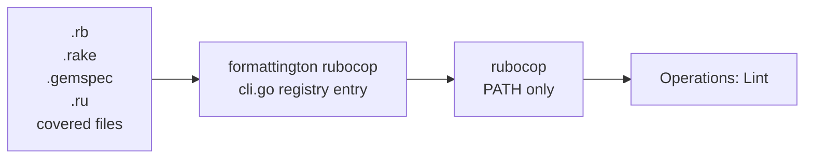

# RuboCop (`rubocop`)

RuboCop is a **linter with ~100 layout cops** for Ruby (`.rb`, `.rake`, `.gemspec`, `.ru`), integrated like powershell/markdownlint rather than like a formatter. It never writes files unless the user explicitly passes fix flags.

## At a glance

|                      |                                                            |
| -------------------- | ---------------------------------------------------------- |
| Executable           | `rubocop`                                                  |
| Resolution           | PATH-only (gem-only; bundling was considered and rejected) |
| Extensions           | `.rb`, `.rake`, `.gemspec`, `.ru`                          |
| Operations           | Lint                                                       |
| Language aliases     | `ruby` -> `rubocop`                                        |
| Native configuration | `.rubocop.yml` (hierarchical, `inherit_from` supported)    |

## Behavior

- Default invocation: `rubocop` — lint posture; findings exit 1, no findings exit 0.
- `--check`: same lint invocation (all modes are the same non-modifying lint).
- `--dry-run`: same as `--check`.
- Forwarded arguments: verbatim; Formattington never injects fix flags — `-x` (`--fix-layout`), `-a`, and `-A` are passed through untouched. `formattington rubocop -x` is the format-like invocation.
- Exit codes: no remapping; findings exit 1, config errors exit 2.

## Notes

- `-x` applies layout-only corrections and never changes semantics.
- Plain `formattington rubocop` lints and is not a gofmt-style formatter; pass `-x` for layout fixes or `-a`/`-A` for all auto-corrections.
- `.rubocop.yml` is hierarchical (`inherit_from`) and discovered natively; `inherit_from:` may reference `https://` URLs (remote fetch at run time) and `require:`/`plugins:` are executed Ruby code — see the untrusted-repositories guidance in [README.md](../../README.md).
- Projects should pin their own version (a project Gemfile, or `gem install rubocop`); Ruby ≥ 2.7 is required (3.x recommended).
- Alternatives documented upstream of this repo: Rufo (dedicated formatter, `--check` exits 3) and Standard (opinionated RuboCop wrapper).

## Related pages

- [Command dispatch and the tool registry](cli.go.md)
- [Tool discovery, bundling, and shared subprocess helpers](tools.go.md)
- [Execution options and the Formatter contract](formatter.go.md)
- [AGENTS.md](../../AGENTS.md)
- [README.md](../../README.md)
- Upstream: https://github.com/rubocop/rubocop
