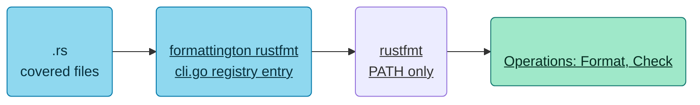

# rustfmt (`rustfmt`)

rustfmt is the standard Rust formatter, covering `.rs` files. Formattington detects the edition per file from the nearest Cargo.toml, because rustfmt's own default (2015) is silently wrong for modern crates.

## At a glance

|                      |                                                                           |
| -------------------- | ------------------------------------------------------------------------- |
| Executable           | `rustfmt`                                                                 |
| Resolution           | PATH-only (rustup component; install with `rustup component add rustfmt`) |
| Extensions           | `.rs`                                                                     |
| Operations           | Format, Check                                                             |
| Language aliases     | `rust` -> `rustfmt`                                                       |
| Native configuration | `rustfmt.toml`                                                            |

## Behavior

- Default invocation: `rustfmt [--edition E]` — format in place.
- `--check`: `rustfmt [--edition E] --check` — exit 1 when formatting is needed (also used for parse errors — indistinguishable; stderr disambiguates).
- `--dry-run`: `rustfmt [--edition E] --emit diff` — print a diff, do not modify.
- Forwarded arguments: verbatim; a caller-provided `--edition` wins over the detected one.
- Exit codes: no remapping.

## Notes

- When the caller does not pass `--edition`, the integration walks up from each file for the nearest `Cargo.toml`: `[package] edition` wins, and a member inheriting from a virtual workspace root uses the nearest `[workspace.package] edition`.
- Files are grouped per edition and batched accordingly; the batch order is deterministic (editions sorted) so the aggregated exit code is stable for multi-edition runs.
- Files with no discoverable Cargo.toml anywhere up the tree are formatted with rustfmt's own default.
- `cargo fmt` reads the edition from Cargo.toml and is crate-aware, but it is not a file-list tool, so `rustfmt` is used instead.
- `--check` exit 1 covers both "files differ" and parse errors; the stderr diagnostic distinguishes them.

## Related pages

- [Command dispatch and the tool registry](cli.go.md)
- [Tool discovery, bundling, and shared subprocess helpers](tools.go.md)
- [Execution options and the Formatter contract](formatter.go.md)
- [AGENTS.md](../../AGENTS.md)
- [README.md](../../README.md)
- Upstream: https://github.com/rust-lang/rustfmt
