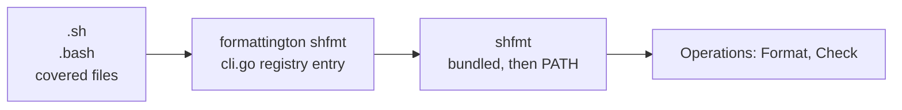

# shfmt (`shfmt`)

shfmt formats shell scripts (`.sh`, `.bash`), from the [mvdan/sh](https://github.com/mvdan/sh) project. Formattington owns the mode; shfmt owns everything else.

## At a glance

|                      |                                                                                                    |
| -------------------- | -------------------------------------------------------------------------------------------------- |
| Executable           | `shfmt`                                                                                            |
| Resolution           | Bundled in the full release archives (no Windows arm64 asset upstream), then `PATH` via `FindTool` |
| Extensions           | `.sh`, `.bash`                                                                                     |
| Operations           | Format, Check                                                                                      |
| Language aliases     | `bash` -> `shfmt`                                                                                  |
| Native configuration | none (flags only)                                                                                  |

## Behavior

- Default invocation: `shfmt -w` — write in place.
- `--check`: `shfmt -l` — list unformatted files; exit 1 if any listed, else 0 (the exit code is derived from the captured output).
- `--dry-run`: `shfmt -d` — print a diff, do not modify.
- Forwarded arguments: verbatim — Formattington owns the mode and shfmt owns all other flags (for example `formattington shfmt -d`).
- Exit codes: no remapping beyond the derived check-mode exit (non-empty `-l` output ⇒ `ExitFormatRequired`, 1).

## Notes

- Check mode uses `-l` (list) rather than a byte comparison; an empty list exits 0, a non-empty list exits 1.
- shfmt has no configuration file; style is controlled entirely through flags such as `-i` (indent), which may be forwarded verbatim or listed in a `.formattington.json` command.
- Install from [mvdan/sh](https://github.com/mvdan/sh) (`brew install shfmt`, `go install mvdan.cc/sh/v3/cmd/shfmt@latest`, or your OS package manager).
- The Linux bundles use the hyphenated `linux-arm64`/`linux-x86_64` layout; underscored bundle names are no longer resolved.

## Related pages

- [Command dispatch and the tool registry](cli.go.md)
- [Tool discovery, bundling, and shared subprocess helpers](tools.go.md)
- [Execution options and the Formatter contract](formatter.go.md)
- [AGENTS.md](../../AGENTS.md)
- [README.md](../../README.md)
- Upstream: https://github.com/mvdan/sh
