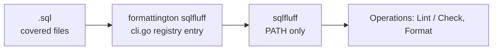

# SQLFluff (`sqlfluff`)

SQLFluff is the dialect-aware SQL linter/formatter, covering `.sql` files. The SQL dialect is never hardcoded: set it in the project config or forward `--dialect`.

## At a glance

|                      |                                                                                                              |
| -------------------- | ------------------------------------------------------------------------------------------------------------ |
| Executable           | `sqlfluff`                                                                                                   |
| Resolution           | PATH-only (Python-only; no official binaries; install with `pipx install sqlfluff` / `pip install sqlfluff`) |
| Extensions           | `.sql`                                                                                                       |
| Operations           | Lint / Check, Format                                                                                         |
| Language aliases     | `sql` -> `sqlfluff`                                                                                          |
| Native configuration | `.sqlfluff`, `[tool.sqlfluff]` in `pyproject.toml`                                                           |

## Behavior

- Default invocation: `sqlfluff fix --disable-progress-bar` — fix in place.
- `--check`: `sqlfluff lint --disable-progress-bar` — exit 1 on violations; files are not modified (exit 2 = error, passed through).
- `--dry-run`: same as `--check` (no diff mode since SQLFluff 3.x — the old `fix --dry-run --diff` flags were removed).
- Forwarded arguments: verbatim; `--config`, `--dialect`, and friends all work natively. `--disable-progress-bar` is added so captured output is deterministic.
- Exit codes: `sqlfluff lint` exit 1 is reported as `ExitFormatRequired` (1); exit 2 (error) passes through untouched.

## Notes

- The dialect is never hardcoded: when the project has a `.sqlfluff` config (or `[tool.sqlfluff]` in `pyproject.toml`) it resolves there; otherwise SQLFluff falls back to `ansi`. Set a dialect (e.g. `dialect = postgres`) in the project config or forward `--dialect` yourself — for example via a config command.
- SQLFluff is Python-only and PATH-only; a shared embedded Python runtime was tracked separately and was not introduced.
- There is no diff mode; `--dry-run` maps to the same read-only `lint` invocation as `--check`.
- `sqlfluff fix` rewrites files in place; `sqlfluff lint` is read-only and is what both check mode and dry-run mode invoke.
- SQLFluff is invoked with `--disable-progress-bar` so captured output is deterministic.

## Related pages

- [Command dispatch and the tool registry](cli.go.md)
- [Tool discovery, bundling, and shared subprocess helpers](tools.go.md)
- [Execution options and the Formatter contract](formatter.go.md)
- [AGENTS.md](../../AGENTS.md)
- [README.md](../../README.md)
- Upstream: https://github.com/sqlfluff/sqlfluff
