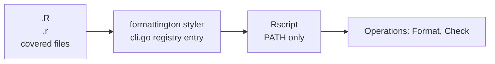

# styler (`styler`)

styler is the de-facto R formatter (tidyverse style), covering `.R` and `.r` files. It is an R package with no standalone executable, invoked through `Rscript -e`.

## At a glance

|                      |                                                                              |
| -------------------- | ---------------------------------------------------------------------------- |
| Executable           | `Rscript` (invoked as `Rscript -e '<expression>'`)                           |
| Resolution           | PATH-only (needs a working R installation plus `install.packages("styler")`) |
| Extensions           | `.R`, `.r`                                                                   |
| Operations           | Format, Check                                                                |
| Language aliases     | `r` -> `styler`                                                              |
| Native configuration | none discovered                                                              |

## Behavior

- Default invocation: `styler::style_file(c(...), dry = "off")` via `Rscript -e` — format in place.
- `--check`: `styler::style_file(c(...), dry = "fail")` — errors out (non-zero) when any file would be modified; reported as `ExitFormatRequired` (1). No files are written.
- `--dry-run`: same as `--check` (it reports which files would change).
- Forwarded arguments: **a forwarded flag is a usage error** — the R expression is constructed inside the integration and user arguments are never spliced into it (injection risk). Non-flag arguments are taken as the file list.
- Exit codes: in check/dry-run mode, any non-zero exit is reported as `ExitFormatRequired` (1); format-mode exit codes pass through.

## Notes

- Advanced customization must go through a wrapper script or R-level `options()` (e.g. `styler::tidyverse_style()`), never through forwarded flags.
- Paths are quoted for R with `strconv.Quote`, which matches R's double-quoted string escapes for the paths Formattington handles.
- CRAN ships a newer release than the stale GitHub tags (CRAN 1.11.0 as of late 2025; GitHub tags trail at v1.10.3 since 2024-04) — install from CRAN.
- Install R for your platform (`apt install r-base` / `brew install r` / the CRAN installer), then `install.packages("styler")`.
- A missing `Rscript` is exit 127; the R expression is built from the file list only, never from user input.

## Related pages

- [Command dispatch and the tool registry](cli.go.md)
- [Tool discovery, bundling, and shared subprocess helpers](tools.go.md)
- [Execution options and the Formatter contract](formatter.go.md)
- [AGENTS.md](../../AGENTS.md)
- [README.md](../../README.md)
- Upstream: https://github.com/r-lib/styler
