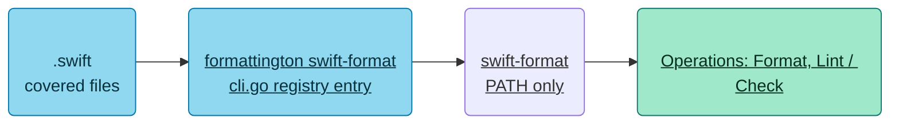

# swift-format (`swift-format`)

swift-format is the official Swift formatter (swiftlang/swift-format), covering `.swift` files. It ships with Swift 6+ toolchains (Xcode 16+) and is PATH-only.

## At a glance

|                      |                                                                                           |
| -------------------- | ----------------------------------------------------------------------------------------- |
| Executable           | `swift-format` (standalone, preferred) or `swift` via `swift format`                      |
| Resolution           | PATH-only (Swift 6+ toolchains; standalone tried first, then `swift format`)              |
| Extensions           | `.swift`                                                                                  |
| Operations           | Format, Lint / Check                                                                      |
| Language aliases     | `swift` -> `swift-format`                                                                 |
| Native configuration | `.swift-format` (JSON; discovered walking up from each file; `--configuration` overrides) |

## Behavior

- Default invocation: `swift format -i --ignore-unparsable-files` (or the standalone equivalent) — format in place.
- `--check`: `swift format lint --strict --ignore-unparsable-files` — exit 1 on findings; files are not modified.
- `--dry-run`: same as `--check` (no diff mode exists).
- Forwarded arguments: verbatim; `--configuration` overrides the discovered `.swift-format`.
- Exit codes: no remapping; check mode exits 1 on findings (via `lint --strict`).

## Notes

- Resolution prefers a standalone `swift-format` on `PATH` (newer standalone installs, e.g. from Homebrew); when absent, it falls back to `swift format`, the subcommand dispatcher included with Swift 6+ toolchains (Xcode 16+). Arguments are identical either way.
- `lint --strict` turns findings into errors (exit 1); without `--strict` findings are warnings and exit 0 — Formattington always uses `--strict` in check mode.
- `--ignore-unparsable-files` skips unparsable input instead of failing the whole batch.
- Configuration is a `.swift-format` JSON file discovered by walking up from each file; `--configuration` overrides it.
- There is no diff mode, so `--dry-run` maps to the same `--strict` lint invocation as `--check`.

## Related pages

- [Command dispatch and the tool registry](cli.go.md)
- [Tool discovery, bundling, and shared subprocess helpers](tools.go.md)
- [Execution options and the Formatter contract](formatter.go.md)
- [AGENTS.md](../../AGENTS.md)
- [README.md](../../README.md)
- Upstream: https://github.com/swiftlang/swift-format
