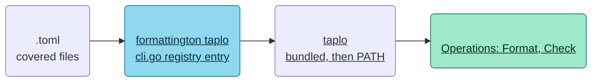

# Taplo (`taplo`)

Taplo formats TOML files via `taplo fmt`, respecting project `taplo.toml` configuration discovered automatically by the tool. Bundled in the full release archives for offline use.

## At a glance

|                      |                                                                                                             |
| -------------------- | ----------------------------------------------------------------------------------------------------------- |
| Executable           | `taplo` (invoked as `taplo fmt`)                                                                            |
| Resolution           | Bundled in the full release archives (`formatters/taplo/<version>/<platform>/`), then `PATH` via `FindTool` |
| Extensions           | `.toml`                                                                                                     |
| Operations           | Format, Check                                                                                               |
| Language aliases     | `toml` -> `taplo`                                                                                           |
| Native configuration | `taplo.toml` / `.taplo.toml`                                                                                |

## Behavior

- Default invocation: `taplo fmt` — format in place (no flag needed).
- `--check`: `taplo fmt --check` — fail if any file needs formatting; files are not modified.
- `--dry-run`: `taplo fmt --diff` — print a diff, do not modify.
- Forwarded arguments: verbatim; no `--config` flag is added unless the caller forwards one. `--colors never` is forced (unless the caller forwards their own `--colors`) so diff/log output is deterministic in captured output.
- Exit codes: no remapping.

## Notes

- `--colors never` is forced for deterministic output on every platform, unless the caller forwards their own `--colors` value.
- Taplo respects project `taplo.toml` configuration, found automatically by Taplo; Formattington never injects `--config`.
- Bundled via `formatters/taplo/update.sh`; a system install works too — download the release binary and put `taplo` on `PATH`, or fetch one into your checkout with `formatters/taplo/update.sh`.
- Taplo has no survey rank (TOML has no Stack Overflow Developer Survey row), so it sorts after all ranked tools in the presentation order.

## Related pages

- [Command dispatch and the tool registry](cli.go.md)
- [Tool discovery, bundling, and shared subprocess helpers](tools.go.md)
- [Execution options and the Formatter contract](formatter.go.md)
- [AGENTS.md](../../AGENTS.md)
- [README.md](../../README.md)
- Upstream: https://github.com/tamasfe/taplo
