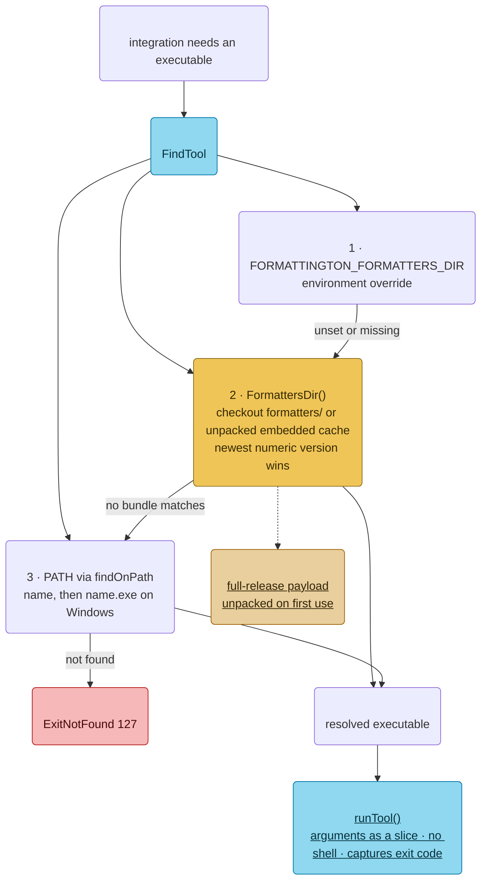

# Tool discovery and subprocess helpers (`tools.go`)

`tools.go` resolves executables for every integration, and owns the shared subprocess plumbing.

## Executable resolution

`FindTool(name, version, verbose)` (line ~286) resolves an integration's executable:

1. `FORMATTINGTON_FORMATTERS_DIR` environment override, if set.
2. The bundled formatter tree — the directory returned by `FormattersDir()` (line ~116), which is either a checkout's `formatters/` (executable-adjacent or ancestor) or the per-user cache into which full-release embedded payloads are unpacked (see [embedded.go.md](embedded.go.md)).
3. `PATH` via `findOnPath` (line ~268); on Windows, both `name` and `name.exe` are tried.

Bundled versions are compared numerically with `versionKey` (line ~178) — `v10` beats `v9` and `v23.1.3` beats `v22.1.8`. `bundledVersions` (line ~221) lists candidate version directories; `findBundledForHost` (line ~242) prefers an explicitly requested version or the newest one carrying a host-platform executable and returns both the path and the version (shared with `list` and the versioner fallback). `hostExecutableName` maps a tool name onto its host executable name (`.exe` on Windows). A missing tool is reported as `ExitNotFound` (`127`); `--verbose` (or `FORMATTINGTON_VERBOSE`) prints the resolved path.

`PlatformDir()` (line ~95) maps the host to the hyphenated `<os>-<arch>` bundle directory name (`linux-x86_64`, `macos-arm64`, `windows-x86_64`, …) used everywhere under `formatters/` and `tools/`.

## Subprocess helpers

`runTool(executable, arguments, captureOutput)` (line ~332) runs the tool with arguments passed as a slice (never a shell string), wiring stdin/stdout/stderr and returning the raw exit code. `captureOutput` asks for output buffering (used by check modes that derive status from stdout, like gofmt's `-l`); otherwise output streams through to the caller. `IsInformational` (line ~59) recognizes help/version-style invocations so discovery does not sprinkle file lists onto them.

Also here: `iterChunks` (batching respecting command-line limits), `contains`, `pathSuffix`, and `repoRoot`/`findRootWithBundles` — the ancestor-directory search for a `formatters/` tree when the binary itself is not inside a checkout.

## Related pages

- [Command dispatch and the tool registry](cli.go.md)
- [Execution options and the Formatter contract](formatter.go.md)
- [File discovery](discovery.go.md)
- [Embedded formatter payload unpacking (full releases)](embedded.go.md)
