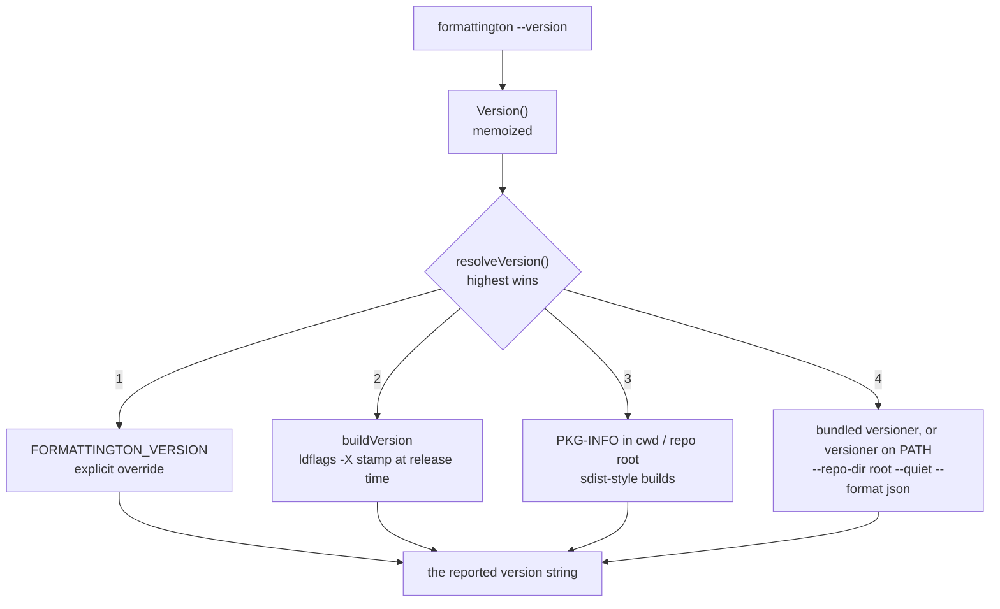

# Version resolution (`version.go`)

`version.go` makes `formattington --version` report the same version the release was tagged with.

## Resolution order

`Version()` (line ~41) memoizes `resolveVersion()` (line ~48), which prefers, highest first:

1. `FORMATTINGTON_VERSION`, if set — an explicit override for CI and testing.
2. `buildVersion` (line ~24) — the version stamped into release binaries at link time (`-ldflags "-X ...internal/formattington.buildVersion=<version>"`), so a binary distributed outside the repository still reports its release tag. Empty for local builds.
3. `versionFromPkgInfo()` (line ~78) — the `Version:` line of a `PKG-INFO` file in the working directory or repository root (sdist-style builds).
4. `bundledVersioner` + `versionFromVersioner` (lines ~104, ~125) — the pinned `tools/versioner/update.sh.md` bundle under `tools/versioner/` (resolved via the shared `findBundledForHost`), or `versioner` on PATH, run as `versioner --repo-dir <root> --quiet --format json` against the repository root.
5. The fallback `0.0.0` with a warning on stderr when none of the above is available.

## Why not a constant

Release binaries must report the exact tag their archive was built from, even outside a repository. Computing the version with `tools/versioner/update.sh.md` at link time — and again at run time as a fallback — keeps one source of truth shared with `scripts/version.sh` and the release pipeline.

## Related pages

- [scripts/version.sh](../../scripts/version.sh.md)
- [Tool discovery, bundling, and shared subprocess helpers](tools.go.md)
- [Command dispatch and the tool registry](cli.go.md)
