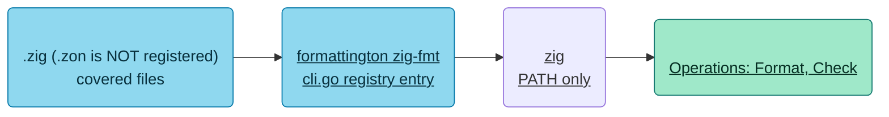

# zig fmt (`zig-fmt`)

zig fmt formats Zig files via the `zig fmt` subcommand that ships with every Zig toolchain release. It is PATH-only and zero-configuration by design.

## At a glance

|                      |                                                                                  |
| -------------------- | -------------------------------------------------------------------------------- |
| Executable           | `zig` (invoked as `zig fmt`)                                                     |
| Resolution           | PATH-only (ships with the Zig toolchain)                                         |
| Extensions           | `.zig` (`.zon` is NOT registered)                                                |
| Operations           | Format, Check                                                                    |
| Language aliases     | `zig` -> `zig-fmt`                                                               |
| Native configuration | none (zero configuration by design — no config file exists and none is invented) |

## Behavior

- Default invocation: `zig fmt` — format in place.
- `--check`: `zig fmt --check` — exit 1 when any file would change.
- `--dry-run`: same as `--check` (there is no diff mode).
- Forwarded arguments: verbatim; pass `--zon` to include `.zon` files (opt-in only).
- Exit codes: no remapping; `--check` exits 1 when any file would change (missing files also exit 1; the stderr diagnostic disambiguates).

## Notes

- Zig is pre-1.0: formatting can drift between toolchain versions. Formattington always invokes the zig found on `PATH`, which matches the project's toolchain by construction.
- `.zon` files are NOT registered; pass `--zon` verbatim to include them.
- Zero configuration by design — there is no config file and none is invented.
- Install Zig for your platform ([ziglang.org](https://ziglang.org/download/)); `zig fmt` ships with every Zig release.

## Related pages

- [Command dispatch and the tool registry](cli.go.md)
- [Tool discovery, bundling, and shared subprocess helpers](tools.go.md)
- [Execution options and the Formatter contract](formatter.go.md)
- [AGENTS.md](../../AGENTS.md)
- [README.md](../../README.md)
- Upstream: https://github.com/ziglang/zig
