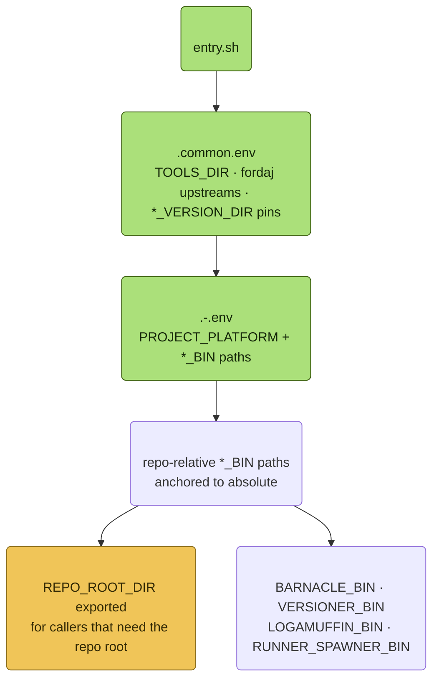

# The environment cascade (`scripts/env.sh` + the hidden `.*.env` files)

`scripts/env.sh` is the plumbing that makes the pinned helper tools resolvable from any script, in any working directory, on every supported platform. It is sourced — never executed — and it works from both bash and zsh.

## What it does

1. Locates the cascade files relative to itself (bash via `$BASH_SOURCE`, zsh via `$ZSH_VERSION`) so sourcing works from any cwd.
2. Brings in `.common.env`, then the platform file selected by `uname -s`/`uname -m` — for example `.macos-arm64.env` or `.windows-x86_64.env`. Unsupported platforms print an error and return `1`.
3. **Anchors** every repository-relative `*_BIN` to the repository root (`REPO_ROOT_DIR`), leaving absolute paths untouched. After sourcing, `$VERSIONER_BIN`, `$LOGAMUFFIN_BIN`, `$RUNNER_SPAWNER_BIN`, and `$BARNACLE_BIN` are absolute.
4. Sets `REPO_ROOT_DIR` for callers that need the repository root (for example [version.sh](version.sh.md)).

Everything is exported with `set -a` while sourcing and un-exported at the end, so the cascade does not leak into the caller's environment beyond the intended variables.

## The hidden files

Hidden files are excluded from barnacle's default scan, so their contract is documented here:

- **`.common.env`** — `TOOLS_DIR=tools`; the upstream `fordaj/*` repository slugs; the pinned `*_VERSION_DIR`s (`versioner`, `logamuffin`, `runner-spawner`, `barnacle`). When bumping a pinned tool, this file names the version directory the platform files point into.
- **`.<platform>.env`** — one per supported platform (`linux-arm64`, `linux-x86_64`, `macos-arm64`, `macos-x86_64`, `windows-arm64`, `windows-x86_64`). Sets `PROJECT_PLATFORM` and the `*_BIN` paths, including `BARNACLE_BIN`. The note about runner-spawner being unsupported on Linux, and the missing Windows-arm64 versioner bundle, are recorded in the platform files themselves.

## Related pages

- [entry.sh.md](entry.sh.md) — the entry point most scripts source (it loads this file and defines `log()`)
- [docs.sh.md](docs.sh.md) — the docs generator that resolves `BARNACLE_BIN` through this cascade
- `../tools/README.md` — the bundles selected by the `*_BIN` variables
