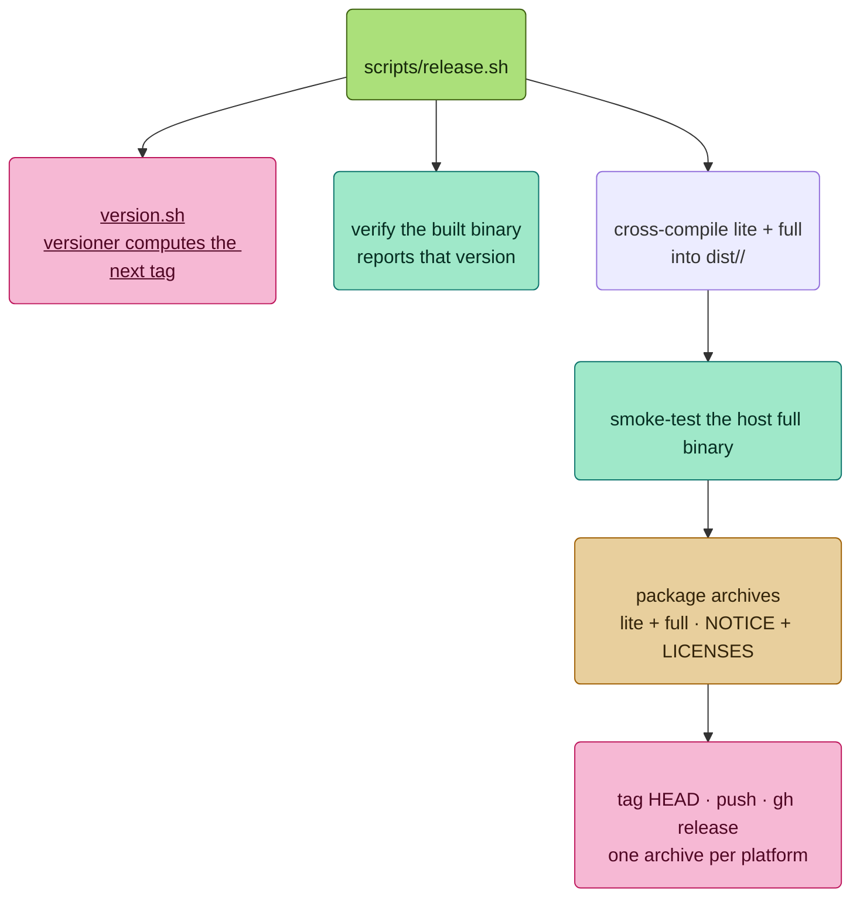

# The release pipeline (`scripts/release.sh`)

`scripts/release.sh` versions, builds, packages, tags, and publishes a GitHub release — two archives per platform. Everything it does flows through the [scripts](README.md) tooling it dogfoods.

## What a release produces

For each of six platforms (`linux-x64`, `linux-arm64`, `macos-x64`, `macos-arm64`, `windows-x64`, `windows-arm64`):

- `formattington-<platform>-lite` — the bare program.
- `formattington-<platform>-full` — the program with its platform's formatter executables embedded in the binary (Go `full` build tag + `go:embed`, unpacked into the per-user cache on first use; see [internal/formattington/embedded.go.md](../internal/formattington/embedded.go.md)).

Both archives carry the binary plus `NOTICE.md` and `LICENSES/` with every bundled tool's attribution. Each archive contains a top-level `formattington-<platform>-{lite,full}/` directory.

## The pipeline

1. Computes the next version with the pinned `tools/versioner/update.sh.md` (via [scripts/entry.sh](entry.sh.md) and [scripts/version.sh](version.sh.md)), using `.versioner.json`. The working tree must be clean for a real release.
2. Fetches the bundled formatters with per-tool `formatters/<tool>/update.sh` (or `FORMATTER_VERSION=<pin>`), each verified at fetch time; a tool that cannot be fetched for a platform is omitted from that platform's full binary with a warning, and a release refuses to proceed when a tool cannot be fetched for any platform. `make dist` runs the same fetch/build/package sequence without tagging.
3. Cross-compiles CGO-disabled binaries into `dist/` with `-ldflags -X ...buildVersion=<version>` stamping.
4. Smoke-tests the host's full binary — with a stripped `PATH` and empty `HOME`, every embedded formatter is invoked with `--version`.
5. Tags `v<version>`, pushes it, and creates the GitHub release with the archives attached. Re-running attaches/refreshes assets on an existing tag instead of failing.

`scripts/release.sh --build-only` stops after step 4; `--dry-run` computes and builds but touches nothing remote; `--allow-latest` permits fetching `FORMATTER_VERSION=latest`. Prerequisites: git, Go 1.24+, and `gh` authenticated for real releases.

## Related pages

- [scripts/README.md](README.md)
- `../tools/versioner/update.sh.md`
- [internal/formattington/embedded.go.md](../internal/formattington/embedded.go.md)
- [README.md](../README.md)
