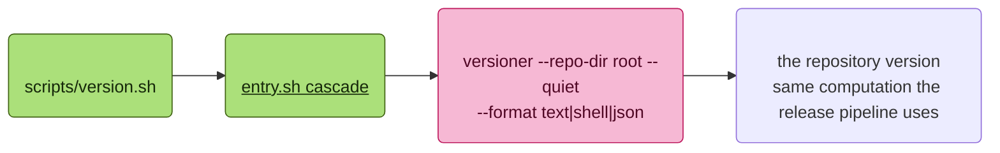

# The version script (`scripts/version.sh`)



Prints the version of this repository as computed by the pinned `tools/versioner/update.sh.md` — the same computation the release pipeline uses, so a local build and the published tag can never drift apart.

## Usage

```bash
scripts/version.sh                 # VERSION=<v> and TAG=<t> lines (default)
scripts/version.sh --format text   # same
scripts/version.sh --format shell  # export VERSION=... and export TAG=...
scripts/version.sh --format json   # the raw versioner JSON document
```

`--format` requires a value; `--help`/`-h` prints usage. Unknown arguments are a usage error (exit `2`).

## How it works

Sources [entry.sh.md](entry.sh.md) for the cascade and `log()`. If `VERSIONER_BIN` is unset or not executable, it fails with `no versioner binary found (run tools/versioner/update.sh or set VERSIONER_BIN)`. Otherwise it runs `versioner --repo-dir <root> --quiet [--format json]`; the repository root defaults to `VERSIONER_REPO_DIR` or the parent of `scripts/`.

## Consumers

- `scripts/release.sh` — computes the next tag, stamps it into the binaries, pushes the tag.
- The release binary itself — see [internal/formattington/version.go.md](../internal/formattington/version.go.md) for how `--version` resolves at run time.

## Related pages

- [entry.sh.md](entry.sh.md) · [env.sh.md](env.sh.md)
- [release.sh.md](release.sh.md)
