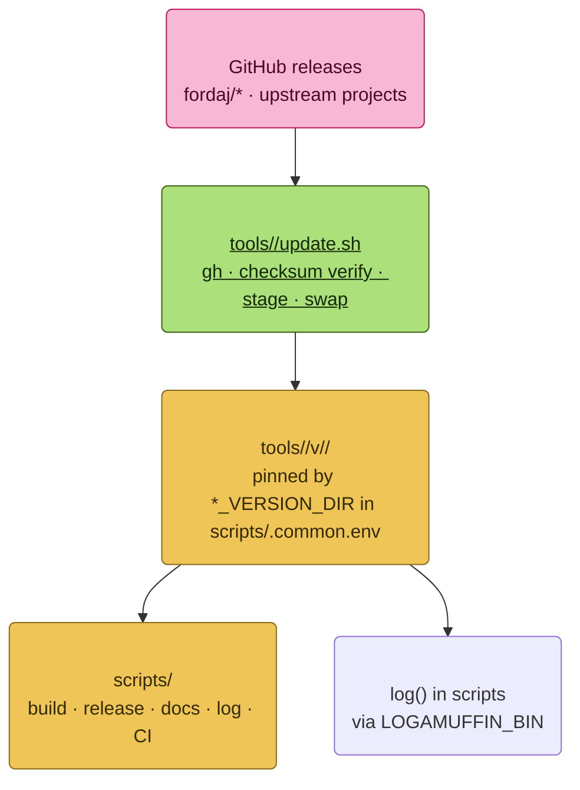

# Pinned helper tools (`tools/`)



`tools/` carries the repository's pinned helper binaries — build, release, logging, and docs tooling — plus one `update.sh` per tool that refreshes them. These are **not** the formatters Formattington orchestrates (those live in `formatters/` and are fetched at release time); they are the tools used to build, test, log, and document this repository itself.

## Bundling convention

Every bundle follows the same layout:

```text
tools/<name>/
  update.sh           # refresh from the upstream GitHub release
  v<version>/<platform>/<binary>[.exe]
```

- Binaries are pinned by version directory; the pinned version is named by `*_VERSION_DIR` in [`scripts/.common.env`](../scripts/env.sh.md).
- `<platform>` is the hyphenated `<os>-<arch>` name (`linux-x86_64`, `macos-arm64`, `windows-x86_64`, …), matching `PlatformDir()`.
- Each bundle's `update.sh` is a thin wrapper around [`tools/update.sh`](update.sh.md), the shared refresh implementation (downloads the latest or `--tag`ged upstream release via `gh`, verifies checksums, stages into a temporary directory, swaps in atomically, and deletes superseded version folders only after the new one is staged — a failed refresh leaves the previous bundle intact). Each wrapper has `--dry-run`, `--help`, and resolves its own directory, so it can run from anywhere.
- Only the binary is kept, except [barnacle](barnacle/update.sh.md), which also retains the upstream MIT `LICENSE` as `<tag>/<platform>/LICENSE`, and [formattington-lite](formattington-lite/update.sh.md), which keeps `NOTICE.md` and `LICENSES/`.

## The bundles

| Tool                                                  | Used for                                                               | Docs                                         |
| ----------------------------------------------------- | ---------------------------------------------------------------------- | -------------------------------------------- |
| [versioner](versioner/update.sh.md)                   | Computes the repository version (tag) for builds and releases          | [update.sh](versioner/update.sh.md)          |
| [logamuffin](logamuffin/update.sh.md)                 | Structured logging backend for `log()` in the scripts                  | [update.sh](logamuffin/update.sh.md)         |
| [runner-spawner](runner-spawner/update.sh.md)         | Manages self-hosted CI runners (driven by `.runner-spawner.json`)      | [update.sh](runner-spawner/update.sh.md)     |
| [barnacle](barnacle/update.sh.md)                     | Renders this documentation site                                        | [update.sh](barnacle/update.sh.md)           |
| [formattington-lite](formattington-lite/update.sh.md) | Stages the released lite binaries locally (not wired into the cascade) | [update.sh](formattington-lite/update.sh.md) |

`scripts/.common.env` and `scripts/.<platform>.env` select these via `*_VERSION_DIR`/`*_BIN`; see [env.sh.md](../scripts/env.sh.md). Archives are platform-native (`.tar.gz` on macOS/Linux, `.zip` on Windows); there is no 7zip dependency anywhere in this repository.

## Refreshing a pinned tool

```bash
tools/barnacle/update.sh            # download the latest release, verify, swap
tools/barnacle/update.sh --dry-run  # show what would change
```

(Same flags for `versioner`, `logamuffin`, `runner-spawner`, `formattington-lite`; see [update.sh.md](update.sh.md) for the shared flags and per-tool parameters.) Refreshes are checksum-verified; all five verifiers accept `checksums.txt` or `SHA256SUMS.txt` (missing file: a warning, except runner-spawner, which refuses to install unverified binaries). Legacy `.7z` assets are still readable (a p7zip install is only needed until new releases ship platform-native archives).

## Related pages

- [update.sh.md](update.sh.md) — the shared refresh implementation behind every wrapper here
- [scripts/env.sh.md](../scripts/env.sh.md) — how the cascade selects these binaries
- [scripts/docs.sh.md](../scripts/docs.sh.md) — barnacle in action
- [../scripts/release.sh.md](../scripts/release.sh.md) — the release pipeline
- [README.md — repository hygiene](../README.md)
